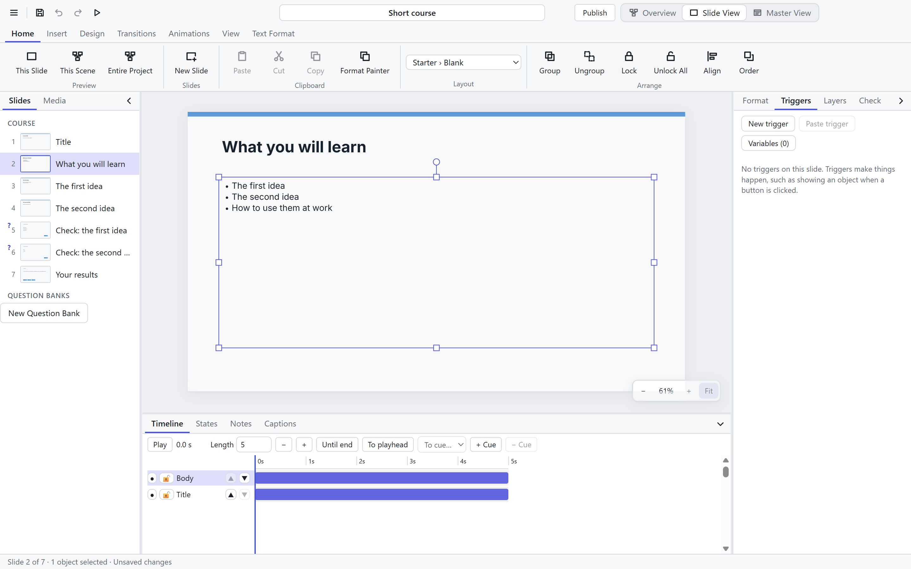
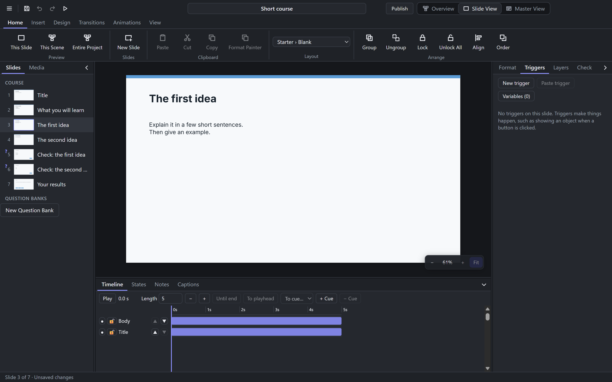
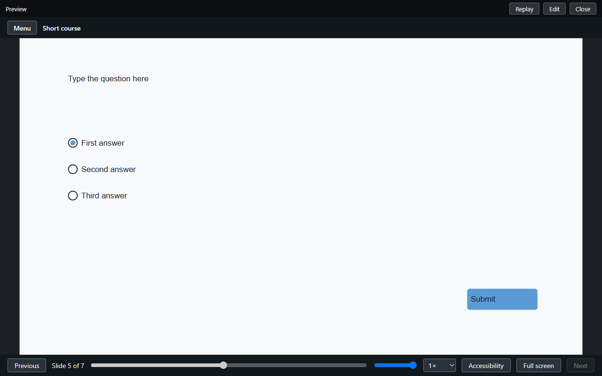

<div align="center">

# 🎬 Vedra Opus

### Build interactive eLearning on your own desktop — and publish it anywhere.

Slides, states, triggers, timelines, quizzes and media, in one app for **Windows, macOS and Linux**.<br>
Courses come out as self-contained HTML5 that reports to any LMS over **SCORM, xAPI or cmi5**.


**[⬇️ Download](https://github.com/lpgeach/vedra-opus-releases/releases)** ·
**[✨ Features](#-what-you-can-make)** ·
**[🛠️ Build from source](#%EF%B8%8F-build-from-source)** ·
**[📚 Docs](#-documentation)**



</div>

---

## 💡 Why Vedra Opus

- **🖥️ Yours, on your machine.** No server, no sign-in, no subscription. A project is a single `.vedraopus` file you can keep, copy and back up.
- **🔒 Private by design.** Nothing about you or your work leaves the computer. A test walks through editing, previewing and publishing and fails if a single request leaves the machine.
- **🚀 Publish once, run anywhere.** A course is plain HTML5 that plays in any modern browser, on desktop or phone, offline or inside your LMS.
- **♿ Accessible from the start.** Real roles and focus order, keyboard dragging, a built-in accessibility checker, and a text view for screen-reader users.

## ✨ What you can make

|                             |                                                                                                                                                                                                    |
| --------------------------- | -------------------------------------------------------------------------------------------------------------------------------------------------------------------------------------------------- |
| **🧱 Slides and objects**   | Text, shapes, pictures, buttons, icons and illustrations, tables, 360° images, web objects, scrolling panels, hotspots and markers, text fields, checkboxes, sliders and dials, and drag-and-drop. |
| **⚡ Interactivity**        | States, layers, triggers with conditions, and variables, with a runtime that behaves the same in the editor's preview and in the published course.                                                 |
| **🎞️ Timeline and media**   | Audio, video and narration recorded in the app; captions, animations, motion paths, transitions, zoom regions and cue points; text-to-speech; screen recording.                                    |
| **📝 Quizzes**              | Graded, survey and freeform questions; correct, incorrect and try-again feedback; question banks with random draws; result slides with scores and review.                                          |
| **🎨 The course player**    | Its menu, tabs, look and labels, lightbox slides, resume, and a layout that adapts to phones and tablets.                                                                                          |
| **🌍 Translation**          | Export to XLIFF or a two-column Word document and back again, with right-to-left languages.                                                                                                        |
| **📦 Publishing**           | Web, SCORM 1.2, SCORM 2004, xAPI and cmi5 packages, a WebM video of the course, and handouts as PDF or Word.                                                                                       |
| **📥 Getting started fast** | Import PowerPoint decks (charts and SmartArt included), start from built-in templates, or save your own.                                                                                           |

<div align="center">


</div>

## ⬇️ Download

Installers are on the **[Releases](https://github.com/lpgeach/vedra-opus-releases/releases)** page of `lpgeach/vedra-opus-releases`.

| System                            | What to get                                                            | Notes                                                                                               |
| --------------------------------- | ---------------------------------------------------------------------- | --------------------------------------------------------------------------------------------------- |
| 🪟 **Windows 10 and 11** (64-bit) | `Vedra Opus-<version>-x64.exe`                                         | The alpha is not signed yet: on **"Windows protected your PC"**, choose **More info → Run anyway**. |
| 🍎 **macOS 11 or later**          | `Vedra Opus-<version>-arm64.dmg` (Apple Silicon) or `-x64.dmg` (Intel) | Not notarised yet: open it once, then **System Settings → Privacy & Security → Open Anyway**.       |
| 🐧 **Linux**                      | Build from source for now                                              | AppImage and deb packages come in the beta.                                                         |

> [!NOTE]
> **This is an alpha.** Everything in the [build plan](docs/PLAN.md) is built and tested, but it is early: expect rough edges, and keep copies of projects you care about. The app's own icon and branding come in the beta ([release stages](docs/release-stages.md)).

## 🛠️ Build from source

You need **Node.js 22.12 or newer**.

```bash
npm install
npm run fetch:ffmpeg        # once: the media tools (our own LGPL ffmpeg build)
npm run fetch:libreoffice   # once: what PowerPoint import draws charts with
npm run dev                 # run the app with hot reload
```

To make an installer for the system you are on: `npm run package` (into `apps/desktop/release`).

<details>
<summary><b>All the commands</b></summary>

| Command                     | What it does                                                                            |
| --------------------------- | --------------------------------------------------------------------------------------- |
| `npm run dev`               | Run the app with hot reload                                                             |
| `npm run build`             | Build main, preload and renderer into `apps/desktop/out`                                |
| `npm run typecheck`         | Type-check every workspace                                                              |
| `npm run lint`              | ESLint, including the package-boundary rules                                            |
| `npm test`                  | Unit tests (Vitest)                                                                     |
| `npm run e2e`               | Build, then run end-to-end tests against the real app (Playwright)                      |
| `npm run test:visual`       | Compare how objects are drawn in Chromium, Firefox and WebKit                           |
| `npm run test:player`       | The course player in Chromium, Firefox and WebKit                                       |
| `npm run test:lms`          | Published SCORM, xAPI and cmi5 packages against in-repo mock LMSs                       |
| `npm run fetch:ffmpeg`      | Build or download the pinned LGPL ffmpeg the media pipeline uses (once)                 |
| `npm run fetch:libreoffice` | Download and trim the pinned LibreOffice PowerPoint import draws charts with (once)     |
| `npm run package`           | Build installers for the current OS into `apps/desktop/release`                         |
| `npm run check:signing`     | Package signed with a throwaway certificate and check it (Windows; `docs/releasing.md`) |
| `npm run collect:sources`   | Gather the source of the ffmpeg and LibreOffice we ship, for a release                  |
| `npm run format`            | Format with Prettier                                                                    |

</details>

<details>
<summary><b>How the code is laid out</b></summary>

```
apps/desktop/        Electron app
  src/main/          Main process: windows, menus, file I/O
  src/preload/       The typed bridge exposed to the renderer as window.vedraopus
  src/renderer/      React editor UI (sandboxed; no Node access)
  src/shared/        IPC contract shared by all three
packages/
  model/             Project schema, validation, migrations, commands
  engine/            Headless course runtime (timelines, states, triggers, variables)
  render/            Object renderers shared by the editor and the player
  player/            The player that ships inside published courses, and its LMS drivers
  publish/           Packaging: web, SCORM, xAPI and cmi5 packages, manifests
e2e/                 End-to-end tests
fixtures/            Sample projects used by tests
docs/                Build plan, development guide, decision records
skills/              Notes for agents and contributors
logs/                Session logs
```

Packages depend on each other in one direction only: `model ← engine ← render ← player ← publish ← apps/desktop`. Lint enforces it.

</details>

## 📚 Documentation

- [docs/PLAN.md](docs/PLAN.md): architecture, runtime rules, and the ordered list of work packages
- [docs/development.md](docs/development.md): the day-to-day development guide
- [docs/player-api.md](docs/player-api.md): the JavaScript API courses can use
- [docs/release-stages.md](docs/release-stages.md): what the alpha holds, and what the beta adds
- [docs/licences.md](docs/licences.md): the third-party software we ship, and its licences
- [AGENTS.md](AGENTS.md): start here if you are an AI agent picking up work
- [skills/project-specific.md](skills/project-specific.md): known issues and conventions

## 🔒 Privacy

Vedra Opus has no telemetry and collects no data: see the **[privacy policy](PRIVACY.md)**. It sends nothing about you or your work anywhere. A test (`e2e/privacy.spec.ts`) goes through editing, previewing and publishing and checks that no request leaves the machine.

Crash reports are off unless you turn on Help → Keep Crash Reports. They are then kept on this computer, never sent; Help → Show Crash Reports opens their folder, so you can choose to share one.

Updates are checked only when you choose Help → Check for Updates…, or once you turn on automatic checks.

## 📄 License

Vedra Opus is free software: you can redistribute it and/or modify it under the terms of the [GNU General Public License](LICENSE) as published by the Free Software Foundation, either version 3 of the License, or (at your option) any later version (`GPL-3.0-or-later`).

It is distributed in the hope that it will be useful, but WITHOUT ANY WARRANTY; without even the implied warranty of MERCHANTABILITY or FITNESS FOR A PARTICULAR PURPOSE. See the [GNU General Public License](LICENSE) for more details.

The third-party software in the app keeps its own licences: see Help → Third-Party Notices… in the app, and [docs/licences.md](docs/licences.md).
