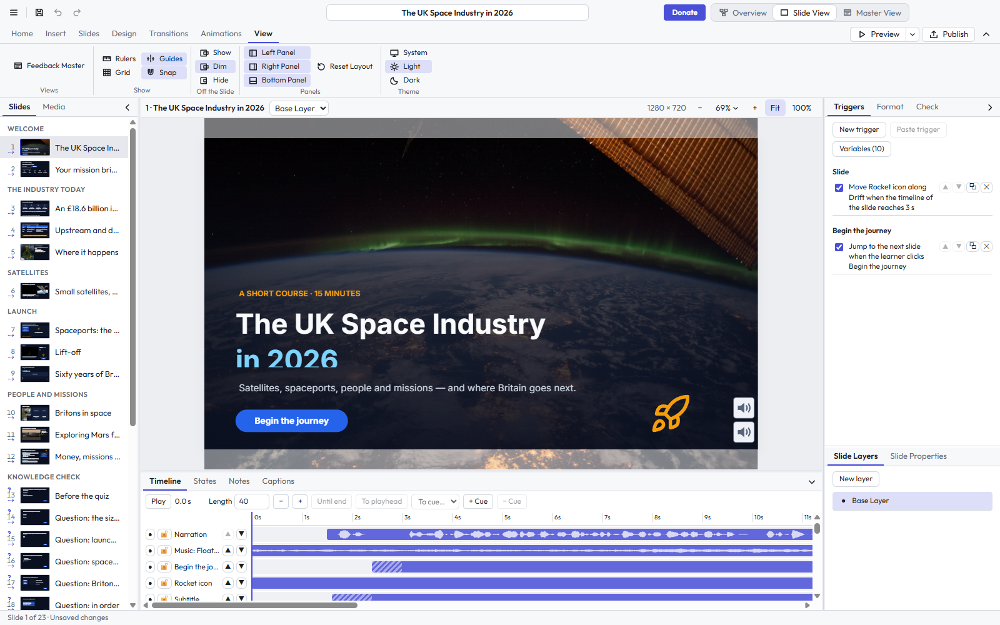

# Vedra Opus help

Vedra Opus is a desktop app for building interactive eLearning courses: slides with layers and triggers, quizzes, sound and video, published for the web or for a learning management system (SCORM, xAPI or cmi5).

These pages explain every part of the app, with pictures taken from it. They describe the latest version of Vedra Opus.

## Start here

1. [Getting started](getting-started.md): installing, the Welcome screen, the demo course, your first project, saving.
2. [The editor](the-editor.md): a tour of the window and the ribbon.

## Building a course

- [Slides and scenes](slides-and-scenes.md): scenes, slides, the Overview, slide properties, masters, layouts and themes.
- [Objects](objects.md): text, shapes, pictures, icons, tables and groups; arranging and formatting them.
- [States and layers](states-and-layers.md): how objects change, and slide layers that appear on top.
- [Triggers and variables](triggers-and-variables.md): making things happen, remembering values, and JavaScript.
- [Timeline and animation](timeline-and-animation.md): timing, cue points, animations, motion paths, transitions and zoom regions.
- [Audio and video](audio-and-video.md): sound, video, narration, captions, text-to-speech and screen recording.
- [Interactive objects](interactive-objects.md): buttons, hotspots, markers, sliders, dials, text entry, scrolling panels, web objects, 360° images and dragging.
- [Quizzes](quizzes.md): questions, Form View, feedback, question banks and result slides.

## Sharing it

- [The player](the-player.md): the frame learners see around your slides.
- [Preview and publish](preview-and-publish.md): trying the course, and publishing it for the web, an LMS, as a video or as a handout.
- [Accessibility](accessibility.md): the accessibility checker, alt text, Tab order and what learners get.
- [Translation](translation.md): translating a course, and right-to-left languages.

## Bringing work in

- [Importing](importing.md): PowerPoint decks, Storyline courses, slides from other projects, and templates.

## The app

- [Settings and updates](settings-and-updates.md): updates, notices, sending feedback.
