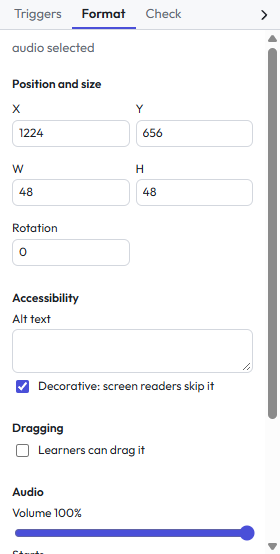
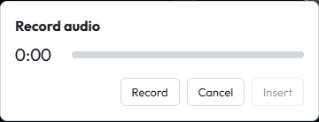
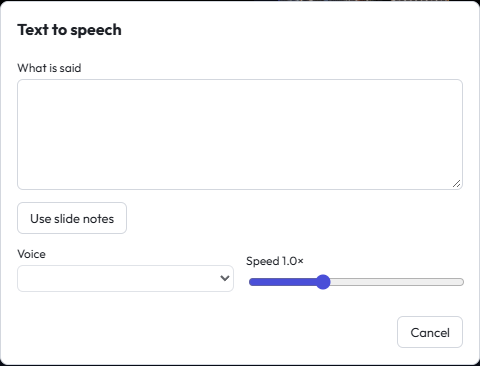
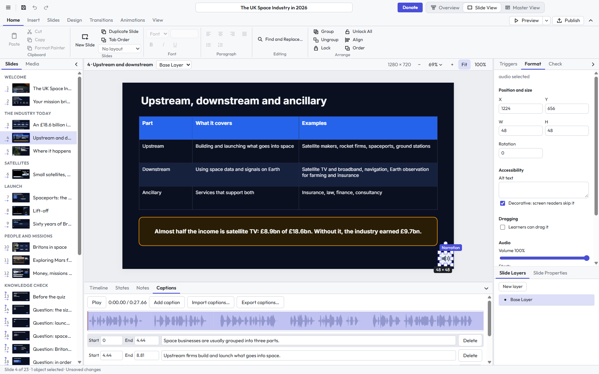

# Audio and video

[Help contents](README.md)

Sound and video sit on a slide's timeline like any other object. Narration can drive the slide: its timeline waits for the sound, so what appears stays in step with what is said.

## Adding sound and video

On the **Insert** tab, under **Media**:

| Command             | What it does                                                                             |
| ------------------- | ---------------------------------------------------------------------------------------- |
| **Audio…**          | A sound from a file.                                                                     |
| **Video…**          | A video from a file.                                                                     |
| **Record Audio…**   | Records narration from your microphone (below).                                          |
| **Text to Speech…** | Narration spoken by one of your computer's voices (below).                               |
| **Import Media…**   | Brings files into the project, to insert later from the **Media** tab of the left panel. |
| **Caption**         | A callout shape, not captions for sound: for those, see [Captions](#captions).           |

Screen recordings are on the **Slides** tab: see [Screen recording](#screen-recording).

**What happens to your files.** Vedra Opus stores sound as MP3 and video as WebM, so courses play in every browser. Files in other formats are converted as they come in, and the status bar shows the progress. The file keeps its name with the new ending: "narration.wav" becomes "narration.mp3".

- **Sound:** MP3, WAV, M4A, OGG and others.
- **Video:** WebM, MP4, MOV and others.
- **H.264 and AAC** (the usual MP4 contents) are converted through Windows' or macOS' own decoders. On Linux they are refused, as Linux has none Vedra Opus may use; convert such files to WebM first.

## Sound

On the stage, a sound is a speaker you can move; learners do not see it. On the timeline, its row shows its waveform.

In the **Format** panel, under **Audio**:

- **Volume.**
- **Starts:**
  - **With the timeline:** it plays when its bar starts, and follows the timeline: pausing, seeking and replaying with it.
  - **When a trigger plays it:** it waits for a **Play media** trigger, for example on a button.

**Narration leads the timeline.** When a sound that starts with the timeline is playing, the slide's timeline follows it. If the sound is slow to load, the timeline waits for it rather than running ahead.

**Triggers for media:** **Play media**, **Pause media** and **Stop media**, and the event **media completes**, for example to show **Next** when the narration ends. See [Triggers and variables](triggers-and-variables.md).

**Browsers that block sound** until the learner has clicked something: the course then shows **Play** over the slide, and starts the sound when it is pressed.

## Video

Select a video to see its settings in the **Format** panel, under **Video**:

- **Volume.**
- **Starts:** **With the timeline**, **When clicked** (the learner clicks the video to play it, and again to pause it), or **When a trigger plays it**.
- **Trim start (s)** and **Trim end (s):** play only part of the file.
- **Poster:** the picture shown before the video plays. **First frame**, or a picture from the project.
- **Show controls:** the browser's own play, pause, seek and volume controls, for learners.
- **Allow picture-in-picture:** lets learners pop the video out into a window of its own. Off unless you turn it on.

A video's timeline row shows its played length, and it follows the timeline as sound does.

## Recording narration

**Insert → Record Audio…**:

1. Press **Record** and speak. A level meter shows the microphone hears you. The first time, your computer may ask whether Vedra Opus can use the microphone.
2. Press **Stop**, and listen to it. **Record again** if you want another take.
3. **Insert** puts the recording on the slide, as MP3. **Discard** throws it away.

## Text to speech

**Insert → Text to Speech…** makes narration from text, with the voices your computer has.

1. Type **What is said**, or press **Use slide notes** to take the slide's notes.
2. Choose a **Voice** and a **Speed**.
3. **Insert** makes the sound and puts it on the slide.

**Voices** come from your computer: Windows' own voices, macOS' `say` voices, and on Linux, espeak-ng if it is installed (`sudo apt install espeak-ng`). Without any, the dialog says so. Nothing is sent over the internet.

## Captions

Captions show what is said, at the foot of the slide, for learners who cannot hear it or prefer to read.

Select a sound or video and open the **Captions** tab of the bottom panel.

- **Play** plays the sound, so you can check the captions against it.
- The **waveform** shows where the speech is.
- **Add caption** adds a line. Give each its **Start** and **End** time, in seconds, and its words.
- **Delete** removes a line.
- **Import captions…** reads a WebVTT (`.vtt`) or SubRip (`.srt`) file, as captioning services and transcription tools make.
- **Export captions…** writes them out the same way, for a captioning service to correct.

**In the course**, the player shows a **CC** button when any slide has captions. Captions are off until the learner turns them on; they then stay on for the rest of the visit. See [The player](the-player.md).

## Screen recording

**Slides → Screen Recording…** records your screen, or one window, as a video for a software demonstration.

1. Choose the screen or the window to record.
2. Record, with narration from your microphone if you want it.
3. Watch it back, then insert it. It goes on the slide as a video, converted to WebM, with a poster picture.

A recording can be up to 10 minutes long. Everything stays on your computer.

## Next

- [Interactive objects](interactive-objects.md)
- [Timeline and animation](timeline-and-animation.md)
