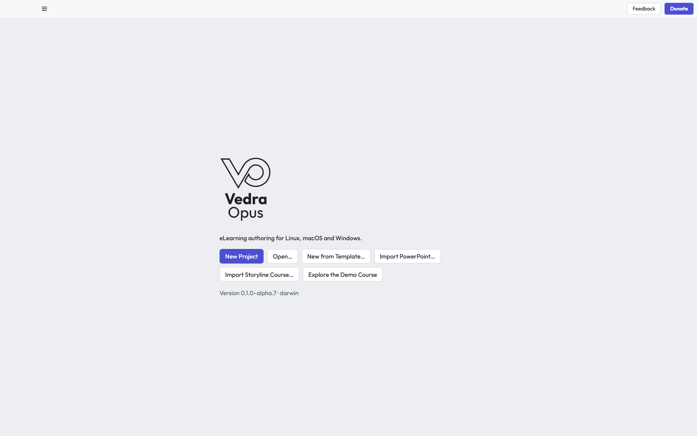

# Getting started

[Help contents](README.md)

## Installing

Download the installer for your computer from the [downloads page](https://github.com/lpgeach/vedra-opus-releases). It has step-by-step instructions for Windows, macOS (Apple Silicon and Intel) and Linux.

## The Welcome screen

When Vedra Opus starts with no project open, it shows the Welcome screen.

| Button                       | What it does                                                                                                     |
| ---------------------------- | ---------------------------------------------------------------------------------------------------------------- |
| **New Project**              | Starts a blank course with one slide.                                                                            |
| **Open…**                    | Opens a project you saved before (a `.vedraopus` file).                                                          |
| **New from Template…**       | Starts a course from a template: one of the starter templates that come with the app, or one you saved yourself. |
| **Import PowerPoint…**       | Makes a new course from a PowerPoint deck. See [Importing](importing.md).                                        |
| **Import Storyline Course…** | Makes a new course from an Articulate Storyline `.story` file. See [Importing](importing.md).                    |
| **Explore the Demo Course**  | Opens a finished sample course to look through, preview and change.                                              |

Projects you opened recently are listed under **Recent**, below the buttons, so you can open them with one click.

The line at the bottom gives the app's version, which is useful when you report a problem.

## The demo course

**Explore the Demo Course** opens _The UK Space Industry in 2026_, a short course made with Vedra Opus. It shows much of what the app can do: scenes, slide layers, triggers and variables, narration and music, animations and transitions, and a short knowledge check.

The demo opens as a new, unsaved copy, so you can change anything without spoiling the original. Press **Preview** to play it as a learner would. You can open it again at any time from **Help → Open Demo Course**.

## Your first project

1. Choose **New Project**. The editor opens with one empty slide.
2. Give the course a name: click the title at the top of the window and type.
3. Add things to the slide from the **Insert** tab: a **Text Box**, a **Picture…**, a **Shape**, a **Button**.
4. Add slides with **New Slide**, on the **Home** or **Insert** tab.
5. Press **Preview** at the right of the ribbon's tab row to try it.
6. Save with **Ctrl+S** (**Cmd+S** on a Mac), or the save button at the top left.

[The editor](the-editor.md) explains each part of the window.

## Saving

- **Save** keeps the project in a single `.vedraopus` file, with its pictures, sound and video inside. Copy or email that one file to move the project.
- **Save As…** saves a copy under a new name.
- **Save as Template…** (in the menu, under File) keeps the project as a template, which **New from Template…** offers from then on.
- The bar at the bottom of the window says whether everything is saved ("Unsaved changes" when it is not).
- Projects made with alpha 4 or earlier open in alpha 5. A project saved in alpha 5 cannot be opened in an earlier version.

### If the app closes unexpectedly

Vedra Opus keeps a working copy of the open project as you go. If the app or the computer stops before you save, the next start shows **Recovered projects** on the Welcome screen: "Vedra Opus did not close properly. These projects had unsaved changes."

- **Recover** opens the project as it was, with your changes. Save it to keep them.
- **Discard** throws the changes away.

## The menu

The ☰ button at the top left opens the menu: **File**, **Edit**, **View**, **Insert** and **Help**. Most of what is in it is also on the ribbon; the menu adds:

- **File:** **Save as Template…**, **Import Slides…**, **Translation…**, **Export Handout…** and **Export Video…**;
- **Help:** **Vedra Opus Help** (this guide, in your browser), **Open Demo Course**, **Check for Updates…**, **Send Feedback…**, **Third-Party Notices…** and **Donate…**.

## Next

- [The editor](the-editor.md): a tour of the window.
- [Slides and scenes](slides-and-scenes.md): organising a course.
