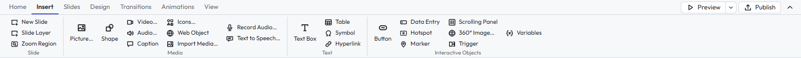

# Interactive objects

[Help contents](README.md)

These are the objects learners do something with: click, type into, drag, turn or explore. Most do their work through [triggers](triggers-and-variables.md) and [variables](triggers-and-variables.md#variables). All of them can be reached and used with the keyboard in the course.

They are on the **Insert** tab, under **Interactive Objects**.

## Buttons

**Button** adds a button with a label. Double-click it to change the words.

Give it a trigger to make it do something: "Jump to the next slide when the learner clicks Continue". A new button has only its **Normal** state: add **Hover** and **Down** on the **States** tab so it reacts as learners expect (see [States and layers](states-and-layers.md#states)).

Any object can be clicked once it has a click trigger, but a button tells learners it can be.

## Hotspots

A **Hotspot** is an invisible area that can be clicked: part of a picture, a region of a map, a control in a screenshot.

- On the stage it shows as a dashed outline labelled "Hotspot". In the course it cannot be seen.
- Its shape is a rectangle or an ellipse (set in the **Format** panel). An ellipse is clickable only inside the ellipse.
- Give it a click trigger, as for a button.
- In the course, keyboard users reach it with Tab and press it with Enter or Space. Its alt text is what screen readers say, so give it one.

## Markers

A **Marker** is a small icon that opens a label when the learner clicks it: a note on a diagram, a point of interest on a map.

- **Its icon:** plus, info, question, pin or star, in a theme colour or any colour.
- **Its label:** a title, words, and optionally a picture or a video and a sound. The label opens beside the marker, and closes when another opens or the slide changes.
- **Pulse:** a ring that grows around the icon to draw the eye. Off unless you turn it on, and never for learners who ask for less motion.

Set all of these in the **Format** panel. Clicking a marker also runs its click triggers.

The demo course's slide 5 (_Where it happens_) has a marker for each place on its map.

## Data entry

**Data Entry** adds a control learners fill in or choose with:

| Control           | What it does                                                      |
| ----------------- | ----------------------------------------------------------------- |
| **Text Entry**    | A box to type text in.                                            |
| **Numeric Entry** | A box for a number, with a least and greatest value if you want.  |
| **Checkbox**      | A box the learner ticks or clears.                                |
| **Radio Button**  | One of a group of round buttons, of which only one can be chosen. |
| **Slider**        | A thumb the learner drags along a track to choose a value.        |
| **Dial**          | A knob the learner turns to choose a value.                       |

### Text and numbers

Link the box to a variable in the **Format** panel: a **Text** variable for a text entry, a **Number** variable for a numeric one.

- The box shows the variable's value when the slide starts.
- What the learner types is written to the variable when they leave the box (with Tab, a click elsewhere, or Enter in a one-line box).
- A number outside the least and greatest value becomes the nearest allowed. Something that is not a number is ignored.
- The event **a control loses focus** runs triggers when the learner leaves the box, after the variable has been written: for example, to check an answer.

The demo course's slide 2 asks for the learner's name this way.

### Checkboxes and radio buttons

- Each has **Normal** and **Selected** states. Use them in conditions: "if Option 2 is Selected".
- **Radio buttons** in the same group allow one choice. A new radio button joins the group of the radio button selected when you insert it; the **Format** panel shows the group's name, and typing another group's name moves it there.
- **Starts checked** makes it start selected.
- Click its words on the stage to change them.

### Sliders and dials

In the **Format** panel:

- the least and greatest value, the **step** between values, and where it starts;
- the **variable** it sets, which follows the control as it moves, so text showing `%Variable%` changes as the learner drags;
- its colours; a slider can run across or upright;
- a dial's look: pointer, pivot, how far it turns, and its face.

The event **a slider or dial moves** runs triggers each time the value changes. Learners using the keyboard move it with the arrow keys (Page Up and Page Down for ten steps, Home and End for the ends).

The demo course's slide 9 (_Sixty years of British space_) uses a slider to move through time.

## Scrolling panels

A **Scrolling Panel** shows a tall area through a window that scrolls up and down, to fit more on a slide.

1. Select the objects that go in the panel.
2. Choose **Scrolling Panel**. They become a group that scrolls, with a window half the group's height.
3. Set the window's height in the **Format** panel. Turn scrolling on or off for any group there.

On the stage, everything in the panel is drawn, so you can still edit what lies below the window. A dashed outline labelled "Scroll window" shows what learners see at once. In the course, learners scroll with the wheel, the scroll bar, touch or the keyboard.

## Web objects

A **Web Object** shows a web page in the slide, or opens it in a new window.

- **A web address** (beginning `https://`): the course loads the page in the learner's browser. The editor and Preview never load it: they show a placeholder naming the address (Preview's has **Open in browser**).
- **A folder** of your own web files, with an `index.html`: copied into the project, and run in Preview and in the course. Up to 2,000 files and 200 MB.
- **In the slide** or **in a new window:** in a new window, the slide shows a button that opens the page.

A web object always runs walled off from the course: it cannot read the course's variables or reach the LMS.

## 360° images

A **360° Image…** is a panoramic photo (the kind 360° cameras make, twice as wide as it is high) that learners look around inside.

- Learners look around by dragging, or with the arrow keys; they zoom with the wheel, or + and −.
- **Spots** are points of interest in the picture. On the stage, the whole picture is shown flat, with each spot as a numbered dot. **Double-click** the picture to add a spot there. In the **Format** panel, give each spot a name (and for a marker, a title and words), change its place, and order the spots.
- **Where the view starts** is also set in the **Format** panel.
- **Free** or **guided:** free lets learners look anywhere and open spots in any order; guided adds **Previous** and **Next** to turn to each spot in your order.
- **Triggers:** the events **the learner opens a spot** and **every spot is opened**.

The demo course's slide 11 (_Exploring Mars from Stevenage_) has a 360° view of Mars.

## Dragging objects

Any object can be made draggable: in the **Format** panel, under **Dragging**, tick **Learners can drag it**.

- It stays where it is dropped, or, with **Goes back after it is dropped** ticked, returns to where it was picked up (its "dropped on" triggers still run).
- **Dragging onto another object:** add triggers with the events **the learner drags an object over another** and **drops an object on another**, for example to show feedback when an item is dropped in the right box. Only the objects those triggers name count as places to drop.
- **Drag Over:** a state the target shows while something is held over it.
- **Overlapping:** the events **two objects intersect** and **two objects stop intersecting** fire when objects come to overlap, or stop, however they moved.

**With the keyboard,** learners press Space or Enter to pick an object up, move it with the arrow keys (Shift for small steps), and Space or Enter to drop it. Escape puts it back.

For drag-and-drop questions that are marked right or wrong, see [Quizzes](quizzes.md).

## Next

- [Quizzes](quizzes.md)
- [The player](the-player.md)
