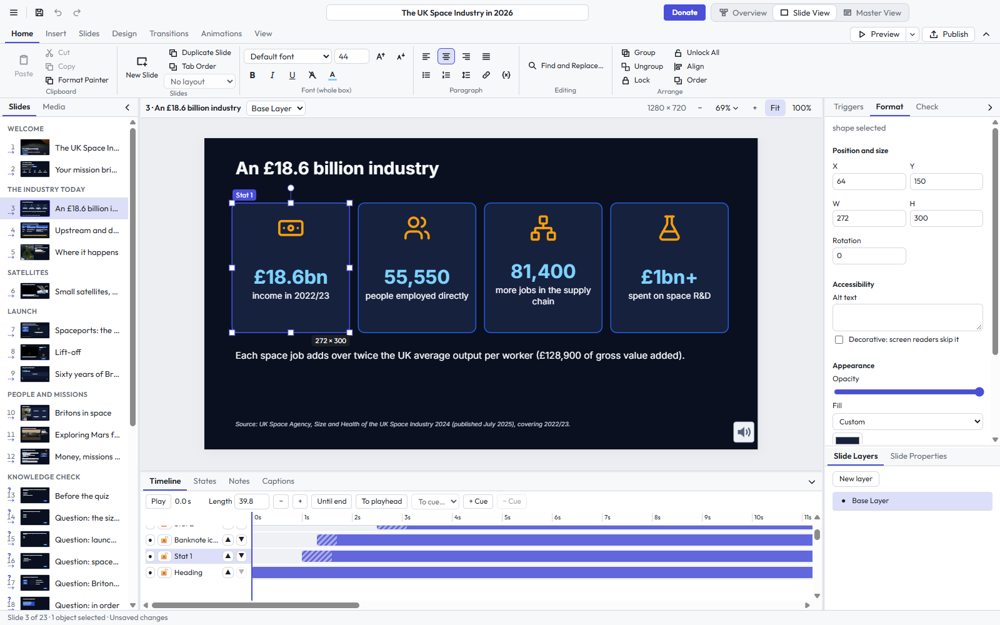
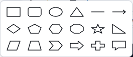
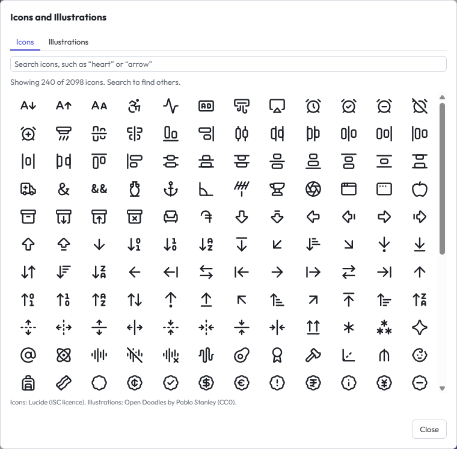
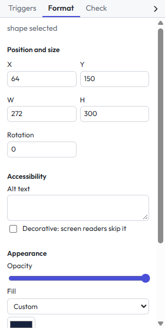

# Objects

[Help contents](README.md)

Everything on a slide is an **object**: a text box, a shape, a picture, a button, a sound. This page covers the objects that show content, and how to select, arrange and format any object. Buttons, hotspots, sliders and the other objects learners use are on [Interactive objects](interactive-objects.md); sound and video on [Audio and video](audio-and-video.md).

## Adding objects

Everything is on the **Insert** tab. A new object appears in the middle of the slide, selected, ready to move.

| Command           | What it adds                                                                                                 |
| ----------------- | ------------------------------------------------------------------------------------------------------------ |
| **Text Box**      | A box to type in.                                                                                            |
| **Picture…**      | A picture from a file on your computer.                                                                      |
| **Shape**         | One of the shapes in its list: rectangles, ovals, triangles, lines, arrows, stars, a speech bubble and more. |
| **Icons…**        | An icon or an illustration from the library (below).                                                         |
| **Caption**       | A callout: rounded, square, oval or cloud, with a pointer.                                                   |
| **Table**         | A table (below).                                                                                             |
| **Symbol**        | A character that is hard to type, such as © or →, into the text you are editing.                             |
| **Hyperlink**     | A link: on the words you have selected while typing, or, with an object selected, a link the learner clicks. |
| **Import Media…** | Pictures, sound and video into the project, to insert later from the **Media** tab of the left panel.        |

### Icons and illustrations

**Insert → Icons…** opens the library:

- **Icons:** more than 2,000 line icons (Lucide). Search by name, for example "heart" or "arrow". Every word you type must match.
- **Illustrations:** drawings of people (Open Doodles).

Click one to insert it. An icon or illustration belongs to the project once inserted: it stays the same whatever version of the app opens it.

**Its colours** are in the **Format** panel: the ink colour (and for illustrations, the accent colour), each a theme colour or a fixed one. Icons also have a line width.

The library's licences allow their use in courses; a published course that uses them carries their notices.

### Tables

**Insert → Table** adds a table. A table is one object, a grid of cells.

- **Typing in a cell:** double-click it. Each cell holds text formatted like a text box's. Press Escape, or click elsewhere, to finish.
- **Rows and columns:** in the **Format** panel's **Table** section, choose a row and a column, then insert a row above or below, a column left or right, or delete the row or column. You can also give that cell its own fill.
- **Its look**, in the same section:
  - a header row and a header column;
  - banded rows;
  - the border's colour and width;
  - the cells' padding;
  - the columns' widths, as shares, for example "1, 2, 1" makes the middle column twice as wide.
- **Resizing** the table scales its rows and columns with it.

In a course, a table is a real table, which screen readers can move through by row and column.

## Text

**Typing:** double-click a text box (or a shape, or a button) to type in it. Click outside it, or press Escape, to finish.

**Formatting**, on the **Home** tab:

- **Font:** the font, the size, **Larger text** and **Smaller text**, bold, italic, underline, clear formatting, and the text colour.
- **Paragraph:** align left, centre, right or justified; bullets and numbering; **Line and paragraph spacing**; **Link**; and **Insert variable** (see [Triggers and variables](triggers-and-variables.md#showing-a-variable-in-text)).
- **Fit:** what a text box does when its text does not fit:
  - **Fixed size:** the box stays as it is;
  - **Shrink text to fit:** the text gets smaller;
  - **Grow box to fit:** the box grows (and shrinks) to fit the text exactly.

These tools change the words you have selected while typing, or, with the box selected and not being typed in, all its text.

**Find and Replace…** (**Home → Editing**) searches the text of every slide. Each match is listed with its slide and object: click one to go to it. **Replace All** changes every match in one step, which one Undo takes back.

**Theme fonts:** choosing **Theme Heading** or **Theme Body** in the font list uses the theme's fonts, so the text changes when the theme does. See [Slides and scenes](slides-and-scenes.md#themes).

## Selecting

- **Click** an object to select it. **Shift-click** adds objects to the selection, or takes them out.
- **Drag** across empty stage to select every object inside the box.
- **Click empty stage**, or press **Escape**, to select nothing.
- Objects hidden under others can be selected from their row on the **Timeline**.
- **Select All** (in the menu, under Edit) selects everything on the slide.

The selected object's name shows above it, and its size below.

## Moving, resizing and rotating

- **Move:** drag the object, or press the **arrow keys** to nudge it.
- **Resize:** drag a handle.
  - Hold **Shift** to keep its proportions.
  - Hold **Alt** (Option on a Mac) to resize about its centre.
- **Rotate:** drag the round handle above it.
- **Cancel:** press **Escape** while dragging to put the object back.
- **Several objects** move, resize and rotate together.

**Snapping:** objects snap to other objects' edges and centres, and to the grid and guides, as you drag; lines show what they line up with. Hold **Ctrl** (Cmd on a Mac) while dragging to stop snapping for that move, or turn **Snap** off on the **View** tab.

**Precise values:** the **Format** panel's **Position and size** section: **X**, **Y**, **W** (width), **H** (height) and **Rotation**.

## Copying and deleting

- **Cut**, **Copy** and **Paste** (on the **Home** tab, or Ctrl+X, Ctrl+C and Ctrl+V). Paste onto another slide to copy objects between slides, or into another open copy of Vedra Opus. Pasted on the same slide, the copy is offset so you can see it.
- **Duplicate** (in the menu, under Edit) copies the selection in one step.
- **Delete** (or the Delete key) removes the selection.

## Arranging

On the **Home** tab, under **Arrange**:

- **Group** makes the selected objects one object, which moves and resizes as one; **Ungroup** separates them. A group's members can still have their own animations and timing.
- **Lock** stops an object being clicked, selected, moved or deleted on the stage, so you do not move it by accident. **Unlock All** unlocks every object on the slide.
- **Align** lines the selected objects up: **Align Left**, **Align Centre**, **Align Right**, **Align Top**, **Align Middle** or **Align Bottom**. With one object selected, it lines up with the slide. **Distribute Horizontally** and **Distribute Vertically** even out the gaps between three or more objects.
- **Order:** **Bring to Front**, **Bring Forward**, **Send Backward** and **Send to Back**.

**Right-click** an object for **Cut**, **Copy**, **Paste**, **Duplicate**, **Delete**, **Group**, **Ungroup**, **Lock**, and **Bring to Front**, **Bring Forward**, **Send Backward** and **Send to Back**. Right-clicking an object that is not selected selects it first.

**Format Painter** (**Home → Clipboard**) copies one object's look to another: select the object whose look you want, click **Format Painter**, then click the object to change. Press Escape to cancel.

## The Format panel

The **Format** tab of the right-hand panel shows the selected object's settings. Which sections show depends on the object.

- **Position and size:** X, Y, width, height and rotation.
- **Accessibility:** **Alt text**, what screen readers say for the object, and **Decorative: screen readers skip it**. See [Accessibility](accessibility.md).
- **Appearance:** **Opacity**, **Fill**, **Stroke** (the outline) and **Shadow**.
  - A colour can be a **theme colour**, which changes with the theme, or **Custom**, a colour of your own.
  - Gradients and pictures are for a slide's background (**Design → Background**).
- **Text box:** its **Autofit** (as **Fit** on the Home tab).
- Sections for particular objects: **Image** (its opacity), **Table**, **Graphic** (an icon's colours), and the interactive objects' own sections.

With several objects selected, a change applies to all of them in one step.

## Next

- [States and layers](states-and-layers.md): objects that change.
- [Triggers and variables](triggers-and-variables.md): making things happen.
