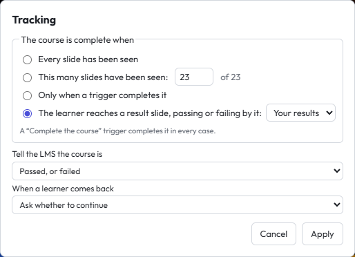
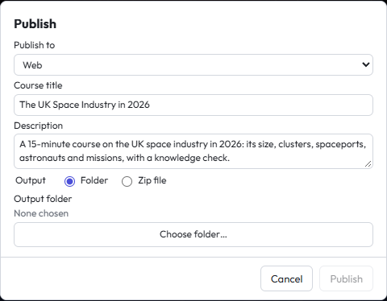

# Preview and publish

[Help contents](README.md)

**Preview** plays the course as learners will see it, without leaving the editor. **Publish** makes the finished course: a web page, or a package for a learning management system (LMS). The course can also be exported as a video or a printed handout.

## Preview

**Preview**, at the right of the ribbon's tab row, plays the course in a window of its own. The arrow beside it chooses what to play:

- **This Slide**;
- **This Scene**;
- **Entire Project**, from the start.

At the top of the Preview window:

- **Replay** starts again.
- **Edit** closes Preview and opens, in the editor, the slide you were watching.
- **Close.**

Preview plays everything a published course does: triggers, variables, layers, sound, video, quizzes, the player and its tabs, and JavaScript. Two exceptions:

- **Web addresses in web objects** are not loaded: a placeholder offers **Open in browser**. See [Interactive objects](interactive-objects.md#web-objects).
- **No LMS** is connected, so tracking is not sent anywhere.

## Tracking

**Design → Tracking** decides when the course counts as finished, what the LMS is told, and what happens when a learner comes back. It matters only for a course published for an LMS.

- **The course is complete when:**
  - **Every slide has been seen**;
  - **This many slides have been seen**;
  - **Only when a trigger completes it** (with the trigger **Complete the course**);
  - **The learner reaches a result slide, passing or failing by it**: choose the result slide. Its score is sent to the LMS. See [Quizzes](quizzes.md#result-slides).

  A **Complete the course** trigger completes it in every case.

- **Tell the LMS the course is:** **Completed, or incomplete**; **Passed, or incomplete**; **Passed, or failed**; or **Completed, or failed**. Ask your LMS's administrator which it expects.
- **When a learner comes back:** **Ask whether to continue**, **Always continue where they left off**, or **Always start from the beginning**.

A learner's place, the slides they have seen, their answers and the course's variables are saved with the LMS, so a course they leave can carry on where they were. A completion they have earned is never taken away by coming back.

## Publishing

**Publish** opens the Publish dialog.

1. **Publish to:**
   - **Web:** a course for any web server, or to open from a folder;
   - **SCORM 1.2** and **SCORM 2004** (choose the **Edition**: 2nd, 3rd or 4th): for most LMSs;
   - **xAPI:** for an LMS or a learning record store (LRS) that uses xAPI (Tin Can);
   - **cmi5:** for an LMS that uses cmi5.
2. **Course title** and **Description:** what the LMS shows.
3. For an LMS: an **Identifier** and **Version** for the package, and **Tell the LMS the course is** (as in Tracking).
4. **Output:** a **Folder**, or a **Zip file** (what an LMS usually wants to upload).
5. **Choose folder…**, then **Publish**.

**When it is done,** the dialog says where the course is. For **Web**, open its `index.html` in a browser to try it.

**What is in it:** the course's own page, its player, and its media. Nothing is fetched from elsewhere, so it works offline and on closed networks. Every course carries the notices of the code and media it ships (`THIRD-PARTY-NOTICES.txt`).

**Where data goes:** a published course talks only to the LMS or LRS it is launched from, and only to report the learner's progress. Web objects you add, and links, are the only other things it opens.

**Before you publish,** the [accessibility checker](accessibility.md) lists anything that would keep some learners out.

## Video

**File → Export Video…** plays the course straight through into a video, as a WebM file: each slide's timeline in order, with its sound.

Branches, questions and clicks are not taken, so a video suits a linear course, a walkthrough, or a preview to send people.

## Handout

**File → Export Handout…** makes a document of the course's slides, to print or send:

- **Layout:** **One slide a page, with its notes**, or **Three slides a page, with lines for notes**;
- **Slides:** **All slides**, or **This scene only**;
- **Export PDF…** or **Export Word…**.

## Next

- [Accessibility](accessibility.md)
- [Translation](translation.md)
