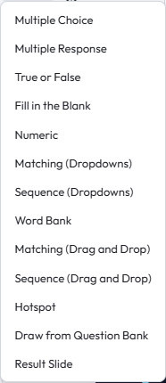
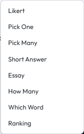
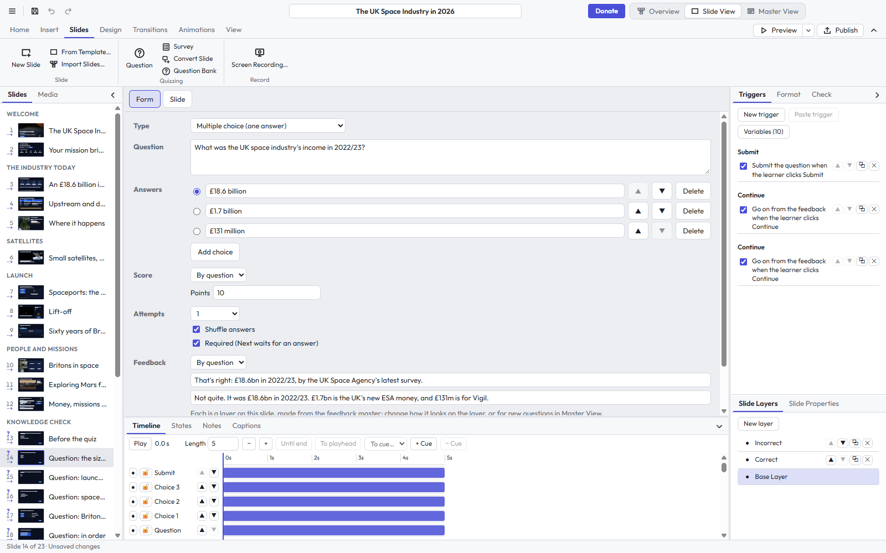
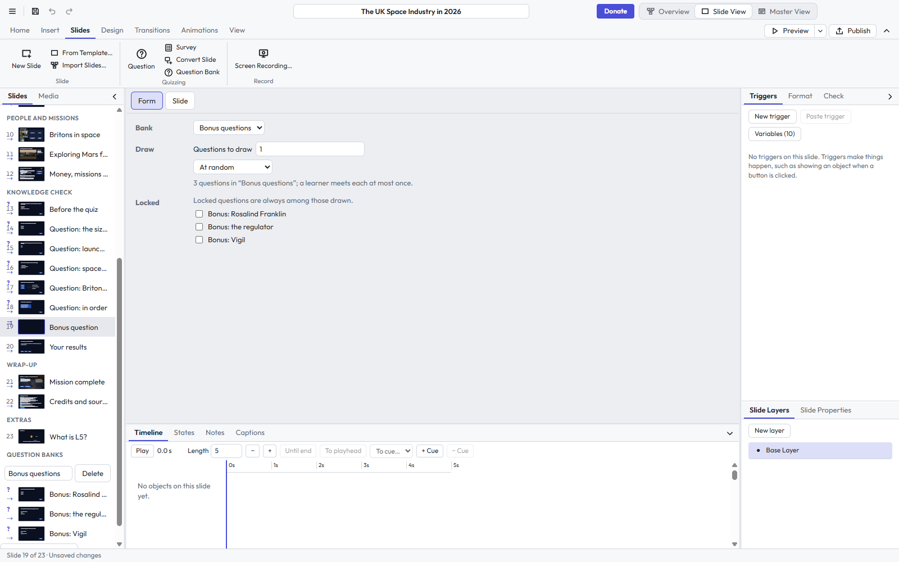
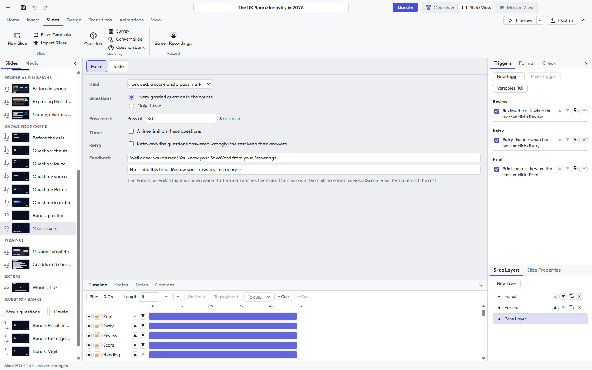

# Quizzes

[Help contents](README.md)

A quiz is made of **question slides**. Questions can be **graded** (right or wrong, with points) or **survey** questions (answered, never wrong). A **result slide** adds up the score, says whether the learner passed, and can report it to an LMS.

## Adding a question

On the **Slides** tab, under **Quizzing**:

- **Question** adds a graded question slide:

  

  | Kind                         | The learner…                                                                                        |
  | ---------------------------- | --------------------------------------------------------------------------------------------------- |
  | **Multiple Choice**          | picks the one right answer                                                                          |
  | **Multiple Response**        | picks every right answer                                                                            |
  | **True or False**            | picks true or false                                                                                 |
  | **Fill in the Blank**        | types the answer                                                                                    |
  | **Numeric**                  | types a number, right if it meets one of your conditions, such as "is 42" or "is between 40 and 45" |
  | **Matching (Dropdowns)**     | matches each item to its partner from a list                                                        |
  | **Sequence (Dropdowns)**     | puts items in order with lists                                                                      |
  | **Word Bank**                | drags words into the gaps in a sentence                                                             |
  | **Matching (Drag and Drop)** | drags each item onto its partner                                                                    |
  | **Sequence (Drag and Drop)** | drags items into order                                                                              |
  | **Hotspot**                  | clicks the right place on a picture                                                                 |

  The same menu has **Draw from Question Bank** and **Result Slide** (below).

- **Survey** adds a survey question:

  

  **Likert** (rate statements on a scale), **Pick One**, **Pick Many**, **Short Answer**, **Essay**, **How Many** (a number), **Which Word** and **Ranking**.

- **Convert Slide** turns the slide you have built into a question of your own design, **freeform**: **Pick One**, **Pick Many**, **Drag and Drop**, **Text Entry**, **Hotspot** or **Shortcut Key**. You then say which of the slide's objects are the choices, the targets or the answer.

The Slides panel marks question slides with a **?**.

## Form View

A question slide opens in **Form View**: the question as a form, rather than as objects on the stage. **Form** and **Slide**, at the top, switch between the two. What you type in the form is the slide's text, so you can lay it out and style it in **Slide** view.

- **Type:** for choice questions, **Multiple choice (one answer)** or **Multiple response (any number of answers)**. Switching keeps the choices.
- **Question:** the question's words.
- **Answers:** each choice, and which are right (the round or square mark beside it). **Add choice**, the arrows to reorder, and **Delete**.
- **Score:** **By question** (points for a right answer) or **By choice** (points for each choice, added up).
- **Attempts:** how many tries the learner has, or **Unlimited**.
- **Shuffle answers:** the choices appear in a different order each time.
- **Required (Next waits for an answer):** the learner cannot move on until they answer.
- **Feedback:** **By question** (one message for right, one for wrong), **By choice** (a message for each choice), or **None**.
- **After answering:** where the learner goes: **Go to the next slide**, or a slide you choose.

Warnings appear in the form when the question cannot work yet, for example with no right answer marked.

## Feedback

Feedback appears on **feedback layers**: **Correct**, **Incorrect**, and **Try again** while the learner has attempts left (survey questions have one, **Thank You**). Each is an ordinary layer on the question slide, so you can change how it looks, add pictures, sound or more triggers. Its **Continue** button runs **Go on from the feedback**.

The words you type under **Feedback** in Form View are the layers' messages.

**The feedback master** gives new feedback layers their look: **View → Feedback Master** opens it in Master View. Change it before you add questions; existing layers keep their own look.

**Submit:** each question has a **Submit** button, with the trigger **Submit the question**. The learner's answer is marked when they press it, and the right feedback layer shows.

## Drag-and-drop questions

**Matching (Drag and Drop)**, **Sequence (Drag and Drop)** and **Word Bank** are ready-made. For your own, **Convert Slide → Drag and Drop** makes a freeform one from the slide's objects, and Form View then offers:

- **One item on each target: the one already there goes back;**
- **Show Drop Correct and Drop Incorrect only after Submit**, so a drop does not give the answer away before the learner submits.

In every drag question, a target's **Drag Over** state shows while an item is held over it. Learners using the keyboard pick items up with Space or Enter, move between targets with the arrow keys, and drop with Space or Enter.

## Question banks

A **question bank** holds questions outside the course's order, to draw from at random: a different set for each learner, or each attempt.

1. **Question Bank** (on the **Slides** tab) makes a bank. Banks are listed under **Question Banks** at the foot of the Slides panel, with their questions.
2. Add questions to the bank as to the course.
3. Add a **Draw from Question Bank** slide where the questions should appear.

On the draw slide:

- **Bank:** which bank to draw from.
- **Questions to draw:** how many, **At random** or in the bank's order.
- **Locked:** questions always among those drawn.

A learner meets each question at most once. The questions drawn are kept with their progress, so a learner who comes back sees the same ones.

## Result slides

**Result Slide** (in the **Question** menu) adds a slide that adds up the quiz.

- **Kind:** **Graded: a score and a pass mark**, or **Survey: how many were answered**.
- **Questions:** **Every graded question in the course**, or **Only these**, chosen from a list. A course can have several result slides, one for each quiz.
- **Pass mark:** pass at this percentage or more.
- **Timer:** a time limit on these questions.
- **Retry:** let the learner retry only the questions they answered wrongly; the rest keep their answers.
- **Feedback:** the words on the **Passed** and **Failed** layers, one of which is shown when the learner arrives.

The result slide's buttons run the triggers **Review the quiz** (go back through the questions, seeing the answers), **Retry the quiz** and **Print the results**.

**The score in text and triggers:** the built-in variables **ResultScore**, **ResultPercent**, **ResultPassed** and the others. See [Triggers and variables](triggers-and-variables.md#built-in-variables).

**Reporting to an LMS:** **Design → Tracking** can complete the course by this result, and send its score. See [Preview and publish](preview-and-publish.md).

## In the demo course

The **Knowledge check** scene has a survey question (_Before the quiz_), five graded questions of different kinds, a **Bonus question** drawn from the _Bonus questions_ bank, and a result slide (_Your results_) with a pass mark of 80%.

## Next

- [The player](the-player.md)
- [Preview and publish](preview-and-publish.md)
