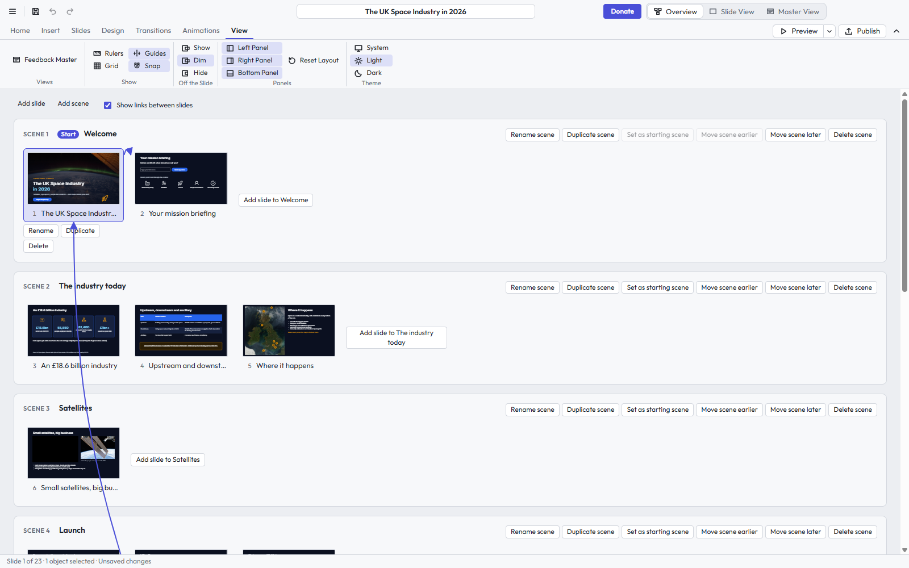

# Slides and scenes

[Help contents](README.md)

A course is made of **slides**, grouped into **scenes**. A scene is a chapter: "Welcome", "The industry today", "Knowledge check". The learner starts at the first slide of the **starting scene** and moves through the slides in order, unless triggers send them elsewhere.

## Adding slides

- **New Slide** (on the **Home**, **Insert** and **Slides** tabs) adds an empty slide after the one you are on, and opens it.
- **Duplicate Slide** (**Home**) copies the slide you are on, with everything on it.
- **From Template…** (**Slides**) adds slides from a template.
- **Import Slides…** (**Slides**) copies slides from another Vedra Opus project. See [Importing](importing.md).
- **Question** (**Slides**) adds a question slide. See [Quizzes](quizzes.md).

## The Overview

**Overview**, at the top right of the window, shows every scene with its slides as cards.

**Above the scenes:**

- **Add slide** and **Add scene**.
- **Show links between slides:** arrows from each slide to the slides its triggers jump to.

**On each scene:**

- **Rename scene**, **Duplicate scene** and **Delete scene** (a course keeps at least one scene).
- **Set as starting scene.** The starting scene is marked **Start**, and is always the first.
- **Move scene earlier** and **Move scene later**.
- **Add slide to …** adds an empty slide at the end of that scene.

**On a slide's card,** when you select it: **Rename**, **Duplicate** and **Delete**.

**Moving slides:** drag a card to another place, in the same scene or another. Drop it on a card to put it before that slide, or on a scene's empty space to put it at the end.

**Opening a slide:** double-click its card, or choose **Slide View**.

**Slides nothing leads to** are marked **Not reachable**: no trigger, button or automatic advance leads there from the first slide, so learners could never see them.

Every change in the Overview can be undone.

## Slide properties

Select the slide's **Slide Properties** tab, in the lower right panel.

- **Moves on:**
  - **When the learner chooses:** the slide waits for the learner to press **Next** (or for a trigger).
  - **By itself when its timeline ends:** the course moves to the next slide when the slide's timeline reaches its end.
- **When revisited:** what the slide does when the learner comes back to it.
  - **Decide automatically**;
  - **Start again**: from the beginning, as the first time;
  - **Carry on where the learner left it**: objects stay in the states the learner left them in.
- **Player buttons on this slide:** whether the player shows **Previous** and **Next** on this slide. A slide without **Next** still moves on through its own triggers. See [The player](the-player.md).
- **Tab order:** the order in which learners using the keyboard reach the slide's objects. See [Accessibility](accessibility.md).

## Backgrounds

**Design → Background** chooses a background for the slide you are on: a colour, a gradient or a picture. Without one, the slide uses its layout's background.

**Hide Layout Objects** (on the same group) leaves out what the slide's layout and master put on every slide, such as a logo, for this slide only.

## Masters and layouts

A **master** holds what many slides share: a background, a logo, the positions of a title and content. Each master has **layouts**, variations such as "Title slide" or "Title and content". Every slide uses one layout.

- **Choosing a slide's layout:** **Home → Slides**, the layout list under **New Slide**.
- **Changing masters and layouts:** **Master View**, at the top right. The left panel then lists **Masters** and their layouts; the stage shows the one you choose.
  - Add objects to a master to show them on every slide that uses it, or to a layout for that layout's slides.
  - **Add title placeholder** and **Add content placeholder** mark where a slide's title and content go. Slides using the layout get a text box there, ready to type in.
- **Back to the slides:** **Slide View**.

The **feedback master** is a special master for quiz feedback. See [Quizzes](quizzes.md).

## Themes

A theme is the course's colours and fonts. Text and shapes that use the theme's colours and fonts change when the theme does.

On the **Design** tab, under **Theme**:

- **The five ready-made themes:** click one to apply it.
- **Colours:** the theme's colours, one by one.
- **Fonts:** the theme's heading and body fonts.

## Stage size

**Design → Stage Size** sets the slides' **Width** and **Height**, for example 1280 × 720 (16:9) or 1024 × 768 (4:3). Under **Existing content**, choose what happens to what is already on the slides:

- **Scale content to new stage:** everything is resized to fit the new size;
- **Keep content size (crop/margins):** everything keeps its size, so a smaller stage crops it and a larger one leaves margins.

## Next

- [Objects](objects.md): what goes on a slide.
- [States and layers](states-and-layers.md).
