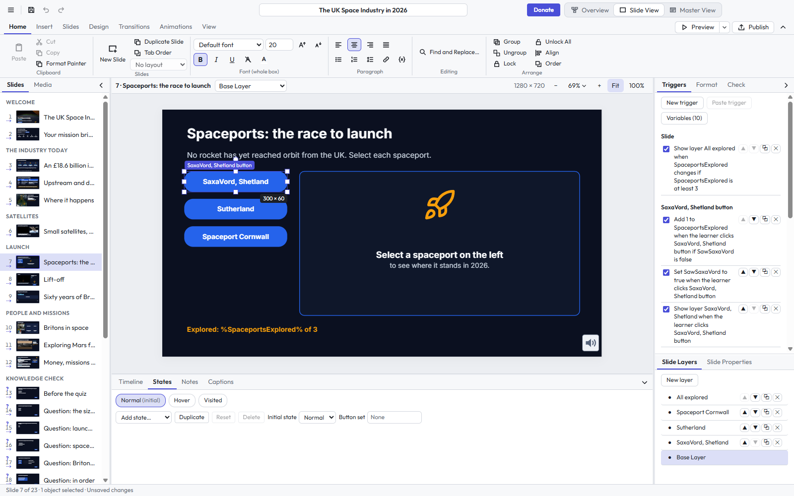
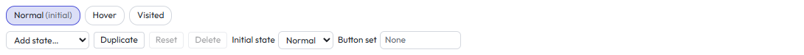
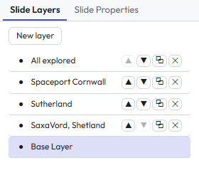
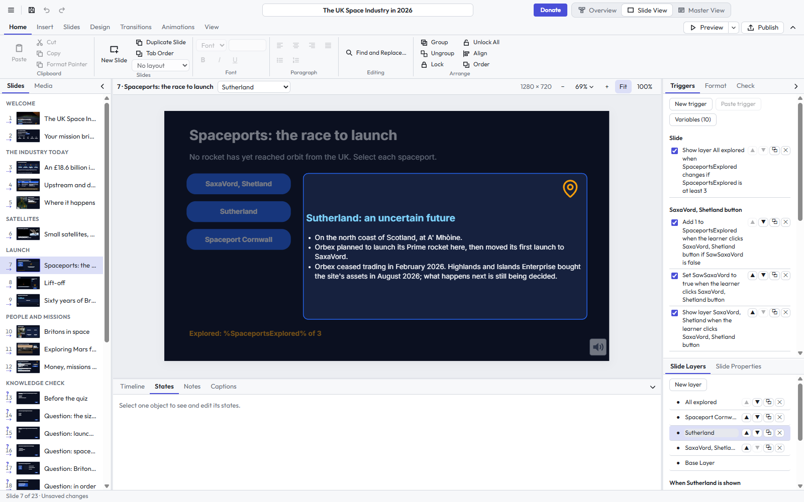

# States and layers

[Help contents](README.md)

Two ways to make a slide change without leaving it:

- an object's **states** are different looks for the same object: a button that lights up when the pointer is over it, or ticks itself once visited;
- a slide's **layers** are extra content that appears over the slide, such as a pop-up, feedback, or the details behind a button.

## States

Select one object and open the **States** tab of the bottom panel. It shows a button for each of the object's states.

### Built-in states

Every object has **Normal**. These others change by themselves, in the course, when the object has them:

| State        | When it shows                                                                                           |
| ------------ | ------------------------------------------------------------------------------------------------------- |
| **Hover**    | While the pointer is over the object.                                                                   |
| **Down**     | While the learner presses the object.                                                                   |
| **Selected** | After the learner clicks it, until something else is selected (in a button set) or it is clicked again. |
| **Visited**  | Once the learner has clicked it, for good.                                                              |
| **Disabled** | When a trigger disables the object. It cannot be clicked.                                               |
| **Hidden**   | When a trigger hides the object.                                                                        |

You can also add **your own states**, with any name, and change to them with a trigger ("change the state of Door to Open").

### Working with states

- **Add state…** adds a built-in state the object does not have yet, or **Custom…**, a state of your own.
- **Click a state** to edit it. The stage shows the object in that state, and everything you change (its colour, text, picture, size or position) changes in that state only. Click **Normal** to go back.
- **Duplicate** copies the state you are editing; **Reset** makes it the same as Normal again; **Delete** removes it.
- **Initial state:** the state the object starts in on the slide.
- **Button set:** give several objects the same set name, and only one of them can be **Selected** at a time, like radio buttons. Choosing one deselects the others.

A state only changes what you change in it. Everything else follows Normal, so changing Normal's colour later still reaches a Hover state that changed only the text.

## Slide layers

Every slide has a **base layer**: what the slide shows to begin with. **Layers** sit on top of it, hidden until a trigger shows them.

The **Slide Layers** tab, in the lower right panel, lists them, the top layer first and the base layer last.

- **New layer** adds a layer, and opens it for editing.
- **Click a layer** to edit it; **double-click** it to rename it.
- The buttons beside each layer move it up or down, duplicate it, or delete it.
- The dot beside each layer shows or hides it **beneath the layer you are editing**, so you can see what it will be shown over. It does not change the course.

While a layer is being edited, the stage shows its objects, with the base layer dimmed beneath. The layer's name is in the stage toolbar, where you can also choose another layer.

### What a layer does when it is shown

Below the list, **When … is shown** sets the layer you are editing:

- **Hide other layers when shown:** showing this layer hides any other layer that is showing.
- **Hide the base layer's objects:** only this layer is seen.
- **Pause the base layer's timeline:** the slide's own timeline waits while the layer shows.
- **Stop clicks on the base layer:** the learner can only use what is on this layer, as in a pop-up.
- **Let the learner move through its timeline:** the player's seekbar works on this layer's timeline.
- **When shown again:** **Decide automatically**, **Start again**, or **Carry on where it was**.

A layer can have its own transition: while it is being edited, the **Transitions** tab sets the layer's transition. See [Timeline and animation](timeline-and-animation.md).

### Showing and hiding layers

Layers appear through triggers: **Show layer** and **Hide layer**. A common pattern:

1. Put a button on the base layer.
2. Make a layer with what the button reveals.
3. Add the trigger "Show layer Details when the learner clicks the button".
4. On the layer, add a **Close** button with "Hide layer Details when the learner clicks Close", or use **Hide other layers when shown** so the next button replaces it.

See [Triggers and variables](triggers-and-variables.md).

In the demo course, slide 7 (_Spaceports: the race to launch_) has one layer for each spaceport. Each button shows its layer and changes to **Visited**, and a fourth layer appears once all three have been explored.

## Next

- [Triggers and variables](triggers-and-variables.md)
- [Timeline and animation](timeline-and-animation.md)
