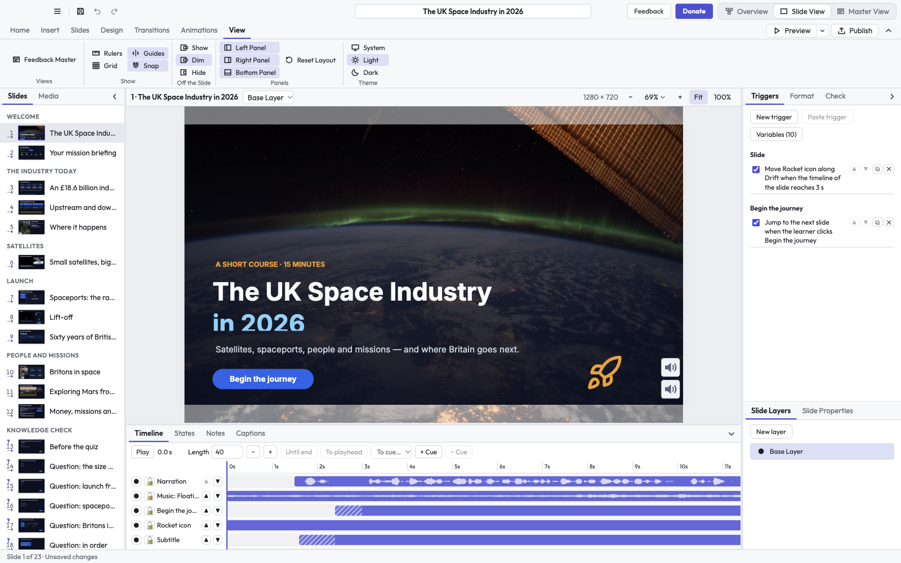
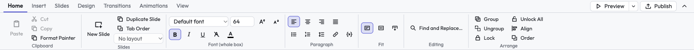
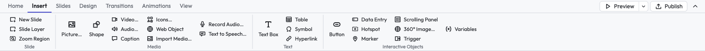
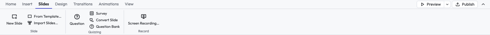
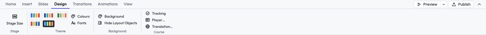
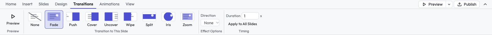
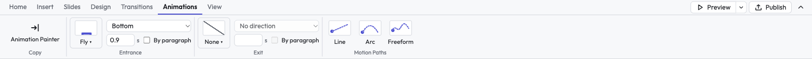
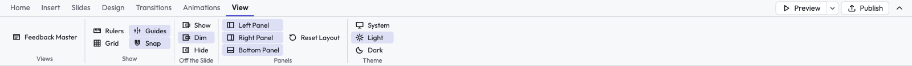
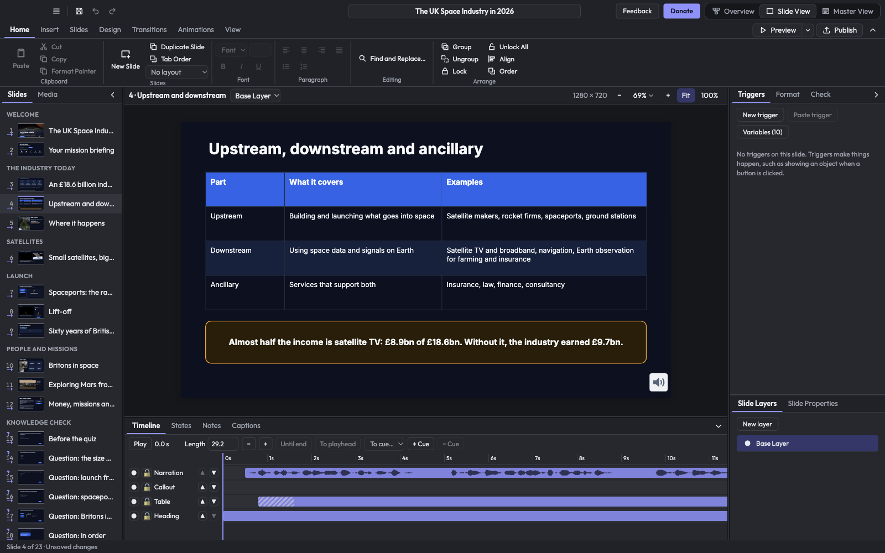

# The editor

[Help contents](README.md)

The window has six parts:

1. **The title bar**, at the top: the menu, Save, Undo and Redo, the course's title, Feedback, Donate and the three views.
2. **The ribbon**, below it: the commands, in seven tabs.
3. **The Slides panel**, on the left: every slide, by scene, and the project's media.
4. **The stage**, in the middle: the slide you are working on, with a toolbar above it.
5. **The right-hand panels:** Triggers, Format and Check above; Slide Layers and Slide Properties below.
6. **The bottom panel:** Timeline, States, Notes and Captions.

## The title bar

- **☰** opens the menu (File, Edit, View, Insert and Help). See [Getting started](getting-started.md#the-menu).
- **Save**, **Undo** and **Redo**. Every change can be undone, one step at a time.
- **The course's title.** Click it to rename the course.
- **Feedback** opens the feedback page in your browser, and **Donate** the page to support Vedra Opus. See [Settings and updates](settings-and-updates.md#sending-feedback).
- **Overview**, **Slide View** and **Master View** switch between:
  - the **Overview**, every slide as a card with arrows showing where each leads (see [Slides and scenes](slides-and-scenes.md#the-overview));
  - **Slide View**, where you build one slide at a time;
  - **Master View**, where you change the masters and layouts that slides are built on (see [Slides and scenes](slides-and-scenes.md#masters-and-layouts)).

## The ribbon

The ribbon holds the commands, grouped by what they are for. Click a tab to see its commands.

| Tab             | What it is for                                                                                                          |
| --------------- | ----------------------------------------------------------------------------------------------------------------------- |
| **Home**        | The clipboard, slides, text (font and paragraph), how a text box fits its text, Find and Replace, and arranging objects |
| **Insert**      | Everything you can put on a slide: media, text, tables, buttons and the other interactive objects                       |
| **Slides**      | New slides, slides from templates or other projects, questions, and screen recording                                    |
| **Design**      | The stage's size, the course's theme, the slide's background, and course settings: tracking, the player and translation |
| **Transitions** | How the slide (or a layer) appears                                                                                      |
| **Animations**  | How objects enter, leave and move                                                                                       |
| **View**        | The feedback master, rulers, grid and guides, what shows past the slide's edges, the panels, and light or dark          |

**At the right of the tab row**, on every tab:

- **Preview** plays the course. The arrow beside it chooses what to play: **This Slide**, **This Scene** or **Entire Project**. See [Preview and publish](preview-and-publish.md).
- **Publish** makes the finished course. See [Preview and publish](preview-and-publish.md).
- **˄** collapses the ribbon to its tabs, to give the stage more room. Click a tab to use its commands; click ˅ to keep the ribbon open again.

**On a narrow window**, some groups show their smaller commands as icons only (point at one to see its name). Narrower still, a group folds into a single button that opens its commands.

**Text tools on Home.** The **Font** and **Paragraph** groups work on the selected text box:

- with a box selected, they change all its text ("Font (whole box)");
- while you are typing in a box, they change the selected words ("Font (selected text)").

The **Fit** group chooses how a text box deals with more text than fits: **Fixed size**, **Shrink text to fit**, or **Grow box to fit**.

## The Slides panel

On the left. Its two tabs:

- **Slides:** every slide in order, under its scene's name. Click a slide to work on it.
  - A small mark beside a slide's number shows it has a transition.
  - To reorder slides or move them between scenes, drag them in the [Overview](slides-and-scenes.md#the-overview).
- **Media:** every picture, sound and video in the project, with **Insert** to put one on the slide. Bring files in with **Insert → Import Media…**.

The **‹** button at its top hides the panel.

## The stage

The slide you are working on.

**Selecting:**

- Click an object to select it. Shift-click to add others.
- Drag across empty stage to select everything inside the box.
- Click empty stage, or press Escape, to select nothing.

The selected object's name shows above it, and its size below.

**Changing objects:**

- Drag an object to move it, or its handles to resize it.
- Double-click a text box to type in it.
- Right-click an object for more commands.

**Moving around:**

- Hold Ctrl (Cmd on a Mac) and turn the mouse wheel to zoom about the pointer.
- Hold Space and drag to pan.

**Past the slide's edges:** you can place objects off the slide, for example to animate them in. **View → Off the Slide** chooses whether they **Show**, are **Dim**, or **Hide** while you work.

### The stage toolbar

Above the stage:

- the slide's number and name;
- the layer you are editing (choose another to edit it, see [States and layers](states-and-layers.md));
- the stage's size, for example 1280 × 720;
- the zoom: **−** and **+**, the zoom level (click it for a list), **Fit** to fit the slide in the window, and **100%**.

## The right-hand panels

Two panels, one above the other. Drag the line between them to give either more room.

**Above:**

- **Triggers:** what happens on this slide, and the course's variables. See [Triggers and variables](triggers-and-variables.md).
- **Format:** the selected object's position, size, fill, outline, text and alt text. See [Objects](objects.md).
- **Check:** the accessibility checker. See [Accessibility](accessibility.md).

**Below:**

- **Slide Layers:** the slide's base layer and its other layers. See [States and layers](states-and-layers.md).
- **Slide Properties:** how the slide behaves, its background and its Tab order. See [Slides and scenes](slides-and-scenes.md#slide-properties).

The **›** button at the top hides the right-hand panels.

## The bottom panel

Below the stage. Its tabs:

- **Timeline:** when each object appears and for how long, cue points, and playing the slide. See [Timeline and animation](timeline-and-animation.md).
- **States:** the selected object's states (Normal, Hover, Selected and your own). See [States and layers](states-and-layers.md).
- **Notes:** notes for the slide, which can be shown to learners or printed in a handout.
- **Captions:** the captions of the selected sound or video. See [Audio and video](audio-and-video.md).

The **˅** button at its right hides the panel.

## The status bar

At the very bottom: which slide this is ("Slide 1 of 23") and whether the project is saved.

## Arranging the window

On the **View** tab:

- **Panels:** show or hide the **Left Panel**, **Right Panel** and **Bottom Panel**. **Reset Layout** puts every panel back as it was.
- **Show:** **Rulers**, **Grid**, **Guides** and **Snap** (objects snap to the grid and guides as you drag them). Drag from a ruler to make a guide.
- **Theme:** **System** (follow the computer), **Light** or **Dark**.

Vedra Opus remembers the panels' sizes and the theme between sessions.

## Next

- [Slides and scenes](slides-and-scenes.md)
- [Objects](objects.md)
