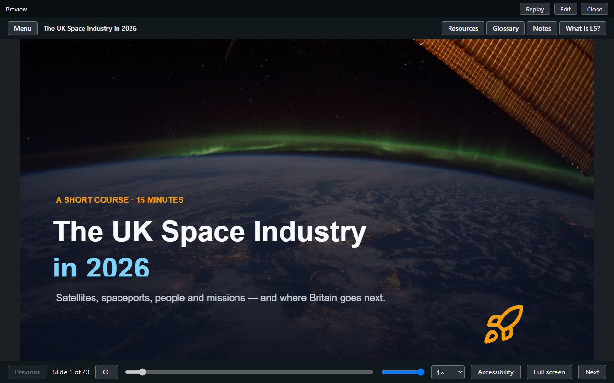
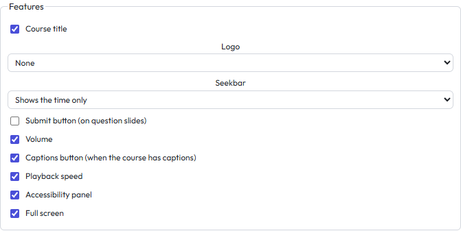
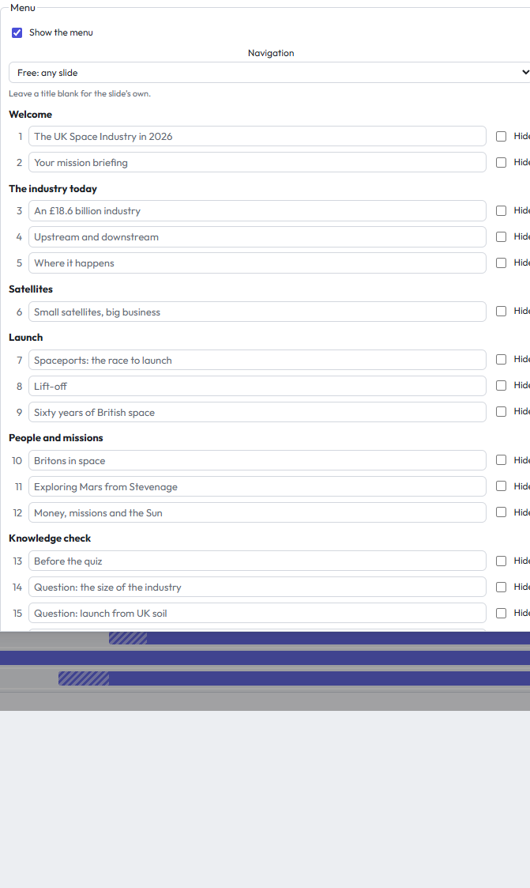
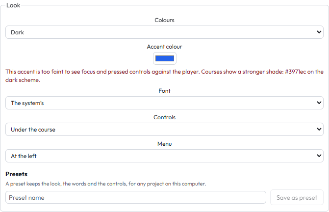
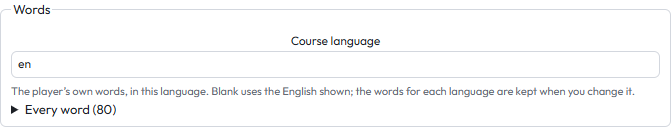

# The player

[Help contents](README.md)

The **player** is the frame learners see around your slides: the course's title and menu at the top; **Previous**, **Next** and the other controls at the bottom; and tabs such as **Resources** and **Glossary**.

Set it up with **Design → Player…**. The dialog has five sections; every change shows in Preview and in the published course.

## Features

What the player shows:

- **Course title**, at the top.
- **Logo:** a picture from the project, at the start of the top bar.
- **Seekbar:** **Off**, **Shows the time only**, or **Learners can drag it** to move through the slide.
- **Submit button (on question slides):** a Submit in the player, for courses whose question slides have none of their own. Off by default.
- **Volume** and **Playback speed:** learners' own, for this visit.
- **Captions button (when the course has captions):** the **CC** button. See [Audio and video](audio-and-video.md#captions).
- **Accessibility panel:** learners' own settings: **Text view** (the slide's text beside it, in reading order), **Text size**, the size of captions, and the course's keyboard shortcuts. See [Accessibility](accessibility.md).
- **Full screen.**

**Previous** and **Next** are always there; each slide can hide them (see [Slides and scenes](slides-and-scenes.md#slide-properties)).

## Menu

The menu lists the course's slides, by scene, for learners to move around.

- **Show the menu.**
- **Navigation:**
  - **Free: any slide**: learners can go to any slide;
  - **Restricted: slides already seen**: only to slides they have been to;
  - **Locked: shows where the learner is only**: the menu shows their place but cannot be used to move.

  These limits apply to the menu. Your own triggers can still go anywhere.

- **Each slide's entry:** type a title for the menu, or leave it blank for the slide's own. **Hide** leaves a slide out of the menu.

## Tabs

Tabs along the top of the player:

- **Resources:** links (each with a title and an address starting `https://`, `http://` or `mailto:`) and files (**Add file…**: a PDF, a worksheet). Files are copied into the project and published with the course. Links open in a new tab.
- **Glossary:** terms and their meanings, shown to learners in alphabetical order.
- **Notes:** each slide's notes (from the **Notes** tab under the stage).
- **Custom tabs:** your own, each either running the slide's triggers (with the event **the learner clicks the player tab**), or opening a slide as a lightbox.

Each has a tick box to show its tab or not.

## Look

- **Colours:** **Light**, **Dark**, or **The learner's system setting**.
- **Accent colour:** the colour of buttons, focus rings and highlights. If it is too faint to see against the player, the dialog says so, and courses use a stronger shade.
- **Font:** **The system's**, or the theme's body or heading font.
- **Controls:** **Under the course** or **Above the course**.
- **Menu:** **At the left** or **At the right**.
- **Presets:** **Save as preset** keeps the look, the words and the controls, to use in any project on this computer.

## Words

- **Course language:** the language of the course, as a code such as `en`, `fr` or `ar`. Screen readers use it to pronounce the course, and right-to-left languages lay the player out from the right.
- **Every word:** each of the player's own words (Next, Previous, Menu, and the others), to change or translate. The words for each language are kept, so changing the language back brings them back.

## Lightboxes

A **lightbox** shows a slide in a window over the course: a reference, a definition, a larger picture. The learner closes it and is where they were.

- The trigger **Open a slide as a lightbox** opens any slide of the course that way, with or without its own **Previous** and **Next**. **Close the lightbox** closes it.
- A custom tab can open one too.
- One lightbox at a time: opening another replaces it.

The demo course's **What is L5?** tab opens the slide _What is L5?_ in a lightbox.

## Phones and tablets

The player adapts by itself; there is nothing to set.

- **On a narrow screen**, it becomes compact, so the slide has as much room as possible.
- **On a touch screen**, every control is at least large enough for a finger, and a quick sideways swipe goes to the next or previous slide.
- **A landscape course on a phone held upright** shows "Turn your device sideways for a bigger view".

## Next

- [Preview and publish](preview-and-publish.md)
- [Accessibility](accessibility.md)
