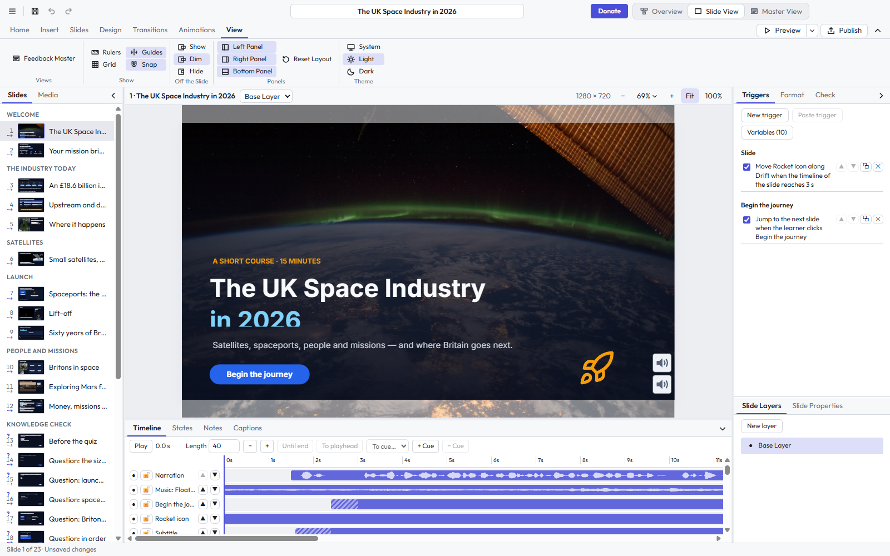
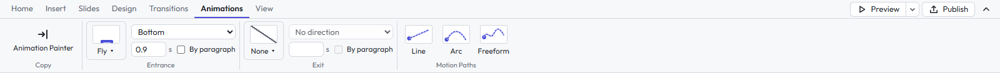
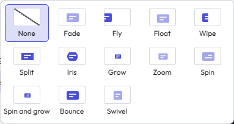
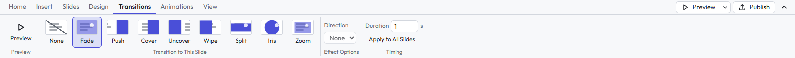

# Timeline and animation

[Help contents](README.md)

Every slide and layer has a **timeline**: how long it lasts, and when each object on it appears and goes. Animations, motion paths, transitions and zoom regions add movement.

## The timeline

The **Timeline** tab of the bottom panel shows the slide you are on, or the layer you are editing.

**Each row** is one object, the frontmost at the top. On each row:

- the dot shows or hides the object on the stage while you work (the course is not affected);
- the padlock locks it, so it cannot be selected or moved on the stage;
- its name: double-click to rename it, click to select the object;
- the arrows bring it forward or send it back;
- its **bar**: when the object is on the slide.

**Bars:**

- Drag a bar to move when the object appears.
- Drag its left edge to change when it appears, keeping when it goes; drag its right edge to change how long it stays.
- Times land on tenths of a second.
- A bar dragged to the end of the timeline stays to the end, however long the slide becomes.
- The shading at a bar's start and end is its entrance and exit animation.

A group shows its members as indented rows under it when selected, each with its own bar.

**The toolbar:**

- **Play** plays the timeline from the playhead, with its sound. The stage shows what the learner would see at each moment. Press **Space** on the stage to play and pause.
- The time at the playhead. Drag the playhead along the ruler to see any moment.
- **Length:** how long the slide (or layer) lasts, in seconds.
- **−** and **+** zoom the timeline out and in.
- **Until end** makes the selected objects stay until the end of the timeline. **To playhead** starts them at the playhead.
- **To cue…** starts the selected objects at a cue point.
- **+ Cue** adds a cue point at the playhead; **− Cue** deletes the selected cue point.

### Cue points

A cue point marks a moment on the timeline, such as where the narration mentions something.

- Add one with **+ Cue**, or press **C** while the timeline plays, to mark moments as you hear them.
- Drag it along the ruler to move it.
- **To cue…** lines objects up with it.
- A trigger can fire when the timeline **reaches a cue point**. See [Triggers and variables](triggers-and-variables.md).

## Animations

Select one object and open the **Animations** tab.

**Entrance** is how the object arrives; **Exit** is how it leaves. Each has a gallery button showing its effect: point at it to see the effect play.

1. Click the gallery button to open the grid of effects: **None**, **Fade**, **Fly**, **Float**, **Wipe**, **Split**, **Iris**, **Grow**, **Zoom**, **Spin**, **Spin and grow**, **Bounce** and **Swivel**. Point at a tile to see it play; click it to choose it. The arrow keys also move through the grid and choose.

   

2. Beside the button:
   - **the direction**, for the effects that take one: **Left**, **Right**, **Top**, **Bottom**, the corners, **Horizontal**, **Vertical**, **Clockwise** or **Anticlockwise**;
   - **the duration**, in seconds;
   - **By paragraph**, for text: each paragraph animates in turn, and the duration is for each paragraph.

Choosing another effect keeps the duration, and the direction when the new effect takes it.

An exit ends as the object's bar ends, so it plays during the last part of the bar.

**Groups:** with a group selected, **Part** chooses the group itself or one of its members, so each part of a group can have its own animation.

**Animation Painter** copies one object's entrance and exit to others: select the object, click **Animation Painter**, then click the object to change.

**Scrub the timeline** or press **Play** to see animations on the stage.

**Learners who ask for less motion** (a setting on their computer) see every entrance and exit as a fade of the same length. Motion paths then put the object straight at the path's end, and zoom regions cut instead of gliding. Timings and triggers stay the same, so the course works the same way for them.

## Motion paths

A motion path moves an object along a line while the slide plays.

1. Select the object.
2. On the **Animations** tab, under **Motion Paths**, choose **Line**, **Arc** or **Freeform**.
   - **Freeform:** draw the path on the stage: press, drag and release. Escape cancels.
3. The path is drawn on the stage. Drag its handles to change it: a line's ends, an arc's start, middle and end, a freeform path's points.

For the path you are editing:

- **Path duration**, in seconds.
- **Path easing:** **Steady**, **Speed up**, **Slow down**, or **Speed up, slow down**.
- **Relative start:**
  - off: the object goes to the path's start, wherever it was, and moves along it;
  - on: the path starts from where the object is, so running it again moves the object further.
- **Delete path.**

**A new path runs when the timeline starts:** adding one also adds the trigger "move along path when the timeline starts". Change that trigger to run the path at another moment, for example when a button is clicked. An object can have several paths.

A trigger can also wait for **an animation completes**, for example to show a layer when an object has arrived.

## Transitions

A transition is how a slide, or a layer, appears.

On the **Transitions** tab:

- **The gallery:** **None**, **Fade**, **Push**, **Cover**, **Uncover**, **Wipe**, **Split**, **Iris** and **Zoom**. Point at one to see it play; click it to choose it.
- **Effect Options:** the direction, for the transitions that have one.
- **Timing:** **Duration**, and **Apply to All Slides**, which gives every slide this one's transition.
- **Preview** plays it on the stage.

**A layer's transition:** while a layer is being edited, the tab sets that layer's transition, which plays when the layer is shown.

A small mark in the **Slides** panel shows which slides have a transition. Learners who ask for less motion see a fade.

## Zoom regions

A zoom region zooms the course in on part of the slide for a while, then back out: to show the detail of a map or a screenshot.

1. **Insert → Zoom Region** adds one at the playhead, lasting 3 seconds. On the stage it is a dashed frame labelled "Zoom".
2. Move and resize the frame over what to zoom in on.
3. Its bar on the timeline sets when the zoom happens.
4. **Zoom speed**, in the **Format** panel: how long zooming in and out takes.

In the course, the view zooms smoothly to fit the frame, and back out when its bar ends. The stage in the editor does not zoom: you see the frame itself.

The demo course's slide 5 (_Where it happens_) zooms in on a map.

## Next

- [Audio and video](audio-and-video.md)
- [Interactive objects](interactive-objects.md)
