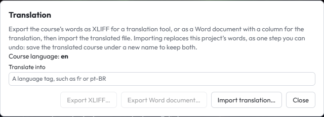

# Translation

[Help contents](README.md)

A course can be translated without retyping it: export its words, have them translated, and import the translation. The course's layout, media, triggers and timing stay as they are.

## Translating a course

**Design → Translation…** (or **File → Translation…**) opens the Translation dialog.

1. **Translate into:** the language, as a language tag, such as `fr` (French), `de` (German) or `pt-BR` (Brazilian Portuguese).
2. Export the words:
   - **Export XLIFF…** for translators and translation tools: XLIFF is the standard file they work with;
   - **Export Word document…** for a person: a table with the original words and an empty column for the translation.
3. Send the file to be translated. In the Word document, only the translation column is filled in; the other columns stay as they are.
4. **Import translation…** reads the translated file back, and replaces the project's words with the translation.

**Keep the original:** importing replaces the words in the project you have open, in one step you can undo. To keep both, save the translated course under a new name: **Save As…**.

**What is translated:**

- the course title, and the scenes' and slides' titles;
- every object's words, in each of its states, including questions, choices, feedback and table cells;
- slide notes, layer names and alt text;
- the hints in text entries, markers' titles and words, 360° images' spots, and web objects' titles;
- captions;
- the player's menu titles, resource titles, glossary, custom tabs, and its own words.

Each line comes with a note saying where it is ("Slide 3 · Text Box 2"), and formatting inside a line, such as a bold word, is kept as numbered tags for the translator to keep in place.

## Right-to-left languages

For a course in Arabic, Hebrew, Persian, Urdu or another right-to-left language, set the **Course language** (**Design → Player…**, under **Words**). The player then lays itself out from the right: the menu, the controls, and Previous and Next.

Within any course, each paragraph runs in its own language's direction, so an Arabic phrase in an English course, or English words in an Arabic one, read correctly.

## The player's words

The player's own words (Next, Previous, Menu, and the rest) are in **Design → Player…**, under **Words**:

- **Course language** chooses the language;
- **Every word** lists them, to change or translate.

The words are kept for each language, so a course can switch between languages without losing any. Importing a translation fills in the player's words for that language when the file has them.

## Next

- [Importing](importing.md)
- [Preview and publish](preview-and-publish.md)
