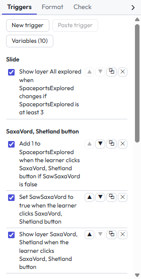
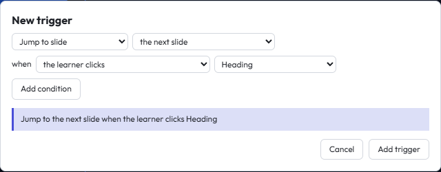
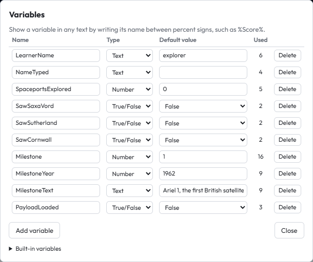

# Triggers and variables

[Help contents](README.md)

A **trigger** makes something happen in the course: "Show layer Details when the learner clicks More". A **variable** remembers something while the learner takes the course: a name they typed, how many spaceports they explored, whether they saw a video.

## Triggers

The **Triggers** tab of the right-hand panel lists the slide's triggers, in plain sentences: first the slide's own, then each object's.

Each trigger has:

- a **tick box** to turn it off without deleting it;
- buttons to move it up or down (triggers for the same moment run from the top down), copy it, and delete it.

**Click a trigger** to change it. **New trigger** adds one; **Paste trigger** pastes one you copied, on this or another slide.

### The trigger wizard

**New trigger** opens the wizard. A trigger is one sentence: an **action**, **when** something happens, and optionally **if** some conditions hold, **otherwise** something else.

The line at the bottom reads the trigger back as a sentence. **Add trigger** saves it.

### Actions

What the trigger does.

| Group              | Actions                                                                                                                                       |
| ------------------ | --------------------------------------------------------------------------------------------------------------------------------------------- |
| Objects and layers | **Change state of**, **Show layer**, **Hide layer**, **Set focus to**                                                                         |
| Moving around      | **Jump to slide**, **Open a slide as a lightbox**, **Close the lightbox**                                                                     |
| Variables          | **Set variable**, **Toggle variable** (true becomes false and back)                                                                           |
| Time and media     | **Pause timeline of**, **Resume timeline of**, **Seek the timeline of**, **Play media**, **Pause media**, **Stop media**, **Move along path** |
| Outside the course | **Open web page**, **Open a file**, **Send an email**, **Print the slide**                                                                    |
| Quizzes            | **Submit the question**, **Go on from the feedback**, **Review the quiz**, **Leave the review**, **Retry the quiz**, **Print the results**    |
| The course         | **Complete the course**, **Restart the course**, **Exit the course**                                                                          |
| Code               | **Run JavaScript** (below)                                                                                                                    |

**Jump to slide** can go to the next or previous slide, or to any slide by name.

**Set variable** sets a variable **to** a value, or changes it by **adding**, **subtracting**, **multiplied by** or **divided by** a number, or for text, **followed by the text**. The value can be typed, or another variable.

### When: the events

When the trigger runs.

- **The learner:** **clicks**, **double-clicks** or **right-clicks** an object; **presses the key** (any key you choose); **clicks the player tab**.
- **The pointer:** **moves onto** or **leaves** an object.
- **The timeline:** **starts**, **ends**, **reaches a time**, or **reaches a cue point**, of the slide or a layer.
- **Changes:** **an object changes state**; **a variable changes**; **media completes**; **an animation completes**.
- **Controls:** **a control loses focus** (a text entry or drop-down the learner leaves); **a slider or dial moves**.
- **360° images:** **the learner opens a spot**; **every spot is opened**.
- **Dragging:** **the learner drags an object over another**; **drops an object on another**; **two objects intersect**; **stop intersecting**.

### If: conditions

**Add condition** makes the trigger run only when something is true. A condition compares:

- a variable with a value or another variable: **is**, **is not**, **is less than**, **is at most**, **is more than**, **is at least**, **contains**, and for text, **is, ignoring case,** and **is not, ignoring case,**;
- an object's state: **is** or **is not** a state, for example "if Door is Open".

With more than one condition, choose **all of these are true** or **any of these is true**.

**Otherwise** adds an action for when the conditions do not hold: "Show layer Correct when the learner clicks Check if Answer is 42, otherwise show layer Try again".

## Variables

**Variables (…)**, on the **Triggers** tab, opens the course's variables. The number is how many it has.

- **Add variable**, then give it a **Name**, a **Type** and a **Default value**: the value it has when the course starts.
- **Types:**
  - **Text**, for words: a name, an answer typed in;
  - **Number**, for counting and scores;
  - **True/False**, for whether something happened.
- **Used** says how many triggers and texts use the variable. Renaming a variable renames it everywhere it is used.
- **Delete** removes it.

Variables belong to the course, not a slide: a value set on one slide is there on every slide after.

When the course is published for an LMS, the variables' values are saved with the learner's progress, so they are still there when the learner comes back. See [Preview and publish](preview-and-publish.md).

### Showing a variable in text

Write the variable's name between percent signs in any text: `Well done, %LearnerName%!` In the course, the learner sees the value: "Well done, Sam!" While you are editing, you see the name.

**Insert variable**, in the **Paragraph** group of the **Home** tab, puts a variable's name in the text you are typing.

### Built-in variables

Under **Built-in variables**, at the foot of the dialog, the values the course keeps by itself. Use them in conditions and in text, like your own:

| Variable              | What it holds                                           |
| --------------------- | ------------------------------------------------------- |
| **SlideNumber**       | The number of the slide the learner is on               |
| **SlideCount**        | How many slides the course has                          |
| **SlidesViewed**      | How many slides the learner has seen                    |
| **PercentComplete**   | How much of the course the learner has seen, in percent |
| **ElapsedSeconds**    | How long the learner has been in the course             |
| **ResultScore**       | The quiz score, on a result slide                       |
| **ResultMaxScore**    | The most the quiz could score                           |
| **ResultPercent**     | The score in percent                                    |
| **ResultPassPercent** | The percentage needed to pass                           |
| **ResultPassed**      | Whether the learner passed                              |
| **ResultTimeLeft**    | The time left on a timed quiz                           |

## JavaScript

**Run JavaScript** runs code you write when the trigger fires, for things the other actions cannot do. The code can read and set the course's variables, and more, through the player's API, described in [docs/player-api.md](https://github.com/lpgeach/vedra-opus-source/blob/master/docs/player-api.md) in the source code.

JavaScript runs in Preview and in the published course. Test it there: the editor does not run it.

## In the demo course

- **Slide 2** (_Your mission briefing_) keeps the name the learner types in **LearnerName**, and greets them by it.
- **Slide 7** (_Spaceports_) counts the spaceports explored in **SpaceportsExplored**, adding 1 the first time each button is clicked (the conditions check **SawSaxaVord** and the others), and shows the **All explored** layer when the count reaches 3.
- **Slide 9** (_Sixty years of British space_) moves **Milestone** with a slider, and shows each milestone's year and words from other variables.

## Next

- [Timeline and animation](timeline-and-animation.md)
- [Interactive objects](interactive-objects.md)
